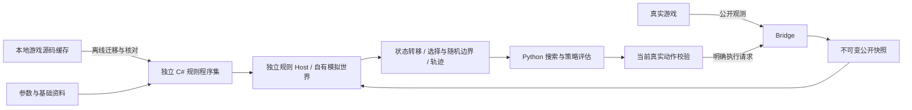

# 游戏原生规则独立复刻与全场景迁移实施方案

建立日期：2026-10-20。状态：**已获用户实施授权，正在按任务依赖迁移；尚未完成全量迁移和默认入口切换。**

本方案记录用户最新确认的方向：**离线复制、迁移游戏已经实现的规则逻辑，按照相同结构在我们自己的代码、进程和状态对象上运行；不直接调用游戏运行中的规则实现。**

本方案是后续规则实施的主入口。它取代旧[游戏模型对齐与跨场景规则审计](游戏模型对齐与跨场景规则审计.md)中“手工 JSON 效果声明作为最终执行定义”的架构选择；旧文档的问题清单、全量范围、交互要求和 A01–A10/S01–S12 待办仍然有效。原[路线与先古事件方案](路线规划与先古事件遗物协同建模方案.md)、[战斗数学模型草案](战斗决策数学模型共建草案.md)的策略目标继续保留，不能用规则迁移替代战略工作。

新架构进度见[独立复刻实施记录](../reference/游戏原生规则独立复刻实施记录.md)，旧实现与历史测试见[历史实施记录](../reference/游戏模型对齐实施记录.md)。后续 AI 必须先阅读本文，不能只根据旧记录继续扩充 JSON 规则。

## 0. 可直接交给实施 AI 的指令

> 在 AutoSlayTheSpire 中实施本方案。目标是独立复刻游戏原生规则层：模型、变量、命令、能力、生命周期和流程沿用游戏的语义结构，效果行为由编译后的代码执行，全部状态属于我们自己的模拟世界。
>
> 不在模拟器中引用、加载或调用安装目录中的 sts2.dll、GodotSharp.dll 或运行中的游戏对象；不通过 Bridge 调用实际游戏动作来试算候选。Bridge 继续负责公开观测和经过校验的真实执行，预测工作与之分开。
>
> 按依赖迁移公共机制和实体模型。已有机制的新实体通过离线同步原模型代码与基础参数接入，不增加按实体 ID 判断的兼容分支，不手写另一份 JSON 效果绑定，不在运行期解释描述或反编译源码。
>
> 保留可复用的策略、搜索、观测边界、合法动作与回执设施。先建立完整独立状态和可复现测试，再推进全量模型、场景接入及战略工作。新规则内核不能只存在于测试中，也不能与旧规则在同一候选中混合执行。
>
> 按本文任务编号持续实施。每阶段完成后记录证据并继续下一项，不因几个示例或一次全绿回归结束整个任务。如出现与用户已确认方向不一致的设计，先停止相关实现并核对；真实外部阻塞、缺失观测及未授权运行验收明确列出，不用空效果或“全量完成”掩盖。

文档编写之后，用户已明确要求“请你按照这个文档进行实现”，代码迁移现已获授权，按上述工作顺序执行。游戏启动、部署及实机操作仍需相应明确授权；不得提前删除尚无完整替代的旧实现。

## 1. 已确认的目标与必须区分的事项

### 1.1 已确认的设计决定

| 编号 | 决定 | 对实现的约束 |
| --- | --- | --- |
| D01 | 独立复刻游戏逻辑 | 迁移后编译的是我们自己的程序集，操作的是我们自己的状态 |
| D02 | 与游戏的语义结构对齐 | 保留模型/变量/命令/能力/钩子/状态机的职责，而不是重新发明一套实体解释器 |
| D03 | 机制行为在代码中 | 条件、循环、目标、顺序、回调、持续时间、升级行为等由模型及核心代码表达 |
| D04 | 基础数据承载参数 | 数值、身份、分类等允许数据更新；不能把效果程序改名为“基础数据”后继续手工维护 |
| D05 | 已有机制不做逐实体兼容 | 公共机制不出现 `if entity_id == ...`，新增实体同步自己的原模型定义即可复用 |
| D06 | 不调用真实游戏做预测 | 禁止修改运行中的游戏对象后回滚；禁止借真实出牌/购买等操作试探候选 |
| D07 | 全量范围与跨场景一致 | 不能只迁移卡牌或几个示例；所有已知规则类别和场景纳入清点与迁移 |
| D08 | 不完整就如实报告 | 模型缺失、状态缺失、未知概率、未定价价值分别表达，不归零、不伪造确定结果 |

### 1.2 “已有机制＋更新基础数据”的准确含义

必须区分以下三种更新：

| 更新类型 | 应有处理 | 是否需要修改公共机制 |
| --- | --- | --- |
| 已有实体仅改参数，例如伤害 8→10 | 更新已确认的参数数据，重新校验和失效缓存 | 不需要 |
| 新增实体，使用已有命令和能力 | 离线同步其模型类、变量/参数及模型引用，编译、注册、运行回归 | 不需要；但新实体自己的模型定义必须进入项目 |
| 新增机制或改变现有机制语义 | 迁移新的公共命令/能力/钩子行为及依赖，增加语义测试 | 需要 |

游戏自身也为每张卡、每种遗物等保留独立模型。**复用机制不等于可以省掉实体自身的定义。** 例如同样的伤害数值不能说明目标是单体还是全体、触发于打出还是抽到、重复几次或是否附带条件。

新实体模型应通过可重复的源码同步流程迁入；不是给我们现有的实体注册表逐项补另一份效果映射。普通反射只能枚举类型、字段和变量，不能自动恢复任意 C# 方法的完整行为。源码迁移也不能被描述成已经解决任意新机制。

### 1.3 本方案不是两种实现方式

- 不是在原游戏进程中克隆部分对象，再调用原始 `OnPlay`、`OnUse` 或 `CombatManager` 进行预测。
- 不是继续在 JSON 中手工写 `on_play → damage → block`，再由 Python 解释执行。

可保留用于序列化的 JSON 请求、快照、参数、覆盖报告和轨迹。**禁止的是让这些文件成为另一套手工效果程序，而不是禁止 JSON 文件本身。**

## 2. 当前基线与迁移边界

### 2.1 已核对的本地依据

- 游戏版本：`0.111.0`。
- 游戏程序集 SHA-256：`0861bfa1df347538d932f22d580e75420f08082792eb914e53b4882764acdbe9`。
- 源码缓存：`.runtime/cache/game-source/`；它是离线迁移与审计输入，不是预测期解释器的输入。
- 数据入口：`data/knowledge/manifest.json`，包含 catalog、source_inventory、behavior、mechanics 等。
- 当前目录统计：596 张卡、299 件百科遗物、66 种药水；合并其他资料后为 1433 个已知 ID。**1433 仍是暂定并集，不是已经证明完整的 ModelDb 分母。**
- 旧 JSON 路线有 436 个游戏模型声明及 5 个内部选择合同；997 个已知 ID 缺声明。声明存在不代表语义已核对，不能直接转换成新内核的支持率。
- 最近完整 Python 回归为 1204 项通过；其后商店药水修正的相关子集为 30 项通过。它们只作为旧实现基线，不能证明独立复刻内核已经存在。

上述数字仅是 2026-10-20 的记录。实施开始时必须重跑清点与基线，不把本文数字永久写死在校验器中。

### 2.2 已有成果如何处理

| 现有部分 | 处理方式 | 最终边界 |
| --- | --- | --- |
| Bridge 的合法动作、回执、观测与选择来源 | 保留并补充缺失公开状态 | 可以引用真实游戏程序集；不承载候选模拟 |
| Python 策略、候选、预算、校准与经验归档 | 保留算法，改接新规则内核 | 不再自行解释效果或推进游戏资源 |
| 地图公开观测缓存 | 保留 | 不导出隐藏节点结果，不生成虚构房间 |
| 百科、别名、图像、源码库存 | 继续作基础资料与溯源 | 不能从文案恢复执行行为 |
| 旧 Python 公共机制及已有测试 | 用作迁移对照和回归素材，逐项按源码核对 | 迁移完成后不保留第二套生产规则 |
| `models/game-0.111.0.json` 的效果/流程声明 | 冻结扩展，标为历史迁移资料 | 不能作为新内核的规则源或未支持实体的回退 |
| `model_store`、旧规则 DSL、怪物/流程解释器 | 迁移期只保留原有路径及独立对照用途 | 切换完成后从默认预测链路移除，确认无消费者后再清理 |
| `effect_profiles`、`entity_reference` | 可以保留参考展示 | 无执行权威，无文案数值评分 |
| 现有覆盖报告 | 保留历史报告，新建独立复刻的证据口径 | 不将旧声明数记为新内核已实现数 |

不得为了“架构清洁”先删除可工作的执行器、用户修改或测试。迁移顺序是建立替代实现、验证与接入，再退役旧规则；禁止恢复用户已删除的工作流或擅自提交。

## 3. 最终架构与工程职责

### 3.1 技术落点

规则内核采用独立 **C#/.NET 项目**，以保留原生类型、泛型、`decimal`、异步回调及继承结构，减少再次翻译规则的偏差。当前仓库项目为 `net9.0`，先与本地可用工具链保持一致；调整目标框架时记录理由，不把升级 SDK 混入机制修复。

策略继续位于 Python。正式切换后，Python 通过本地独立进程访问规则内核。首选带版本的 UTF-8 JSON Lines stdin/stdout 协议，支持批量请求；诊断输出写 stderr，不能混入协议流。不要为规则复刻新增网络服务、HTTP 端口或依赖原游戏 Bridge 存活。

推荐目录（**规划路径，目前尚未创建这些项目**）：

```text
src/csharp/rules/
  AutoSlay.Rules.csproj
  Models/                 # 基类与迁入的实体模型
  Commands/               # 公共命令与命令构建器
  Hooks/                  # 修正、通知、监听顺序
  State/                  # 自有 Run/Combat/Room 状态及实例图
  Variables/              # DynamicVars、Props、费用与升级变量
  Randomness/             # 独立随机流与显式随机请求
  Choices/                # 选择、挂起、继续与取消
  Runtime/                # 模拟世界、命令队列、终局与调度
src/csharp/rules-host/
  AutoSlay.RulesHost.csproj
src/csharp/tools/RuleSourceSync/
src/csharp/tests/RulesTests/
contracts/rules-host.schema.json
data/knowledge/parameters/
data/knowledge/rule-source-manifest.json
src/python/src/autoslay/rule_runtime/
```

实体模型按类别组织；源码同步工具的输出清单记录具体文件归属。不能让重复生成的文件与人工修改的文件相互覆盖。

### 3.2 数据流与边界



规则 Host 不持有 Bridge token、真实动作客户端或游戏存档路径。策略发往 Bridge 的执行请求与发往 Host 的模拟请求必须是不同类型，不能共用一个“execute”方法后由参数决定是否真实执行。

### 3.3 独立性要求

- rules 与 rules-host 的项目引用、传递依赖及发布产物不得包含游戏程序集、Godot、Harmony 或 Bridge。
- 不使用 `Assembly.Load*`、反射、IPC 或进程内指针调用已安装游戏的规则；离线同步工具读取源文件属于不同边界。
- 原 `RunManager.Instance`、`CombatManager.Instance` 等状态依赖改为显式的模拟世界上下文；不能保留进程级可变全局状态供多个候选共用。
- 移除模拟层的文件存档、成就、平台网络、遥测上传等外部副作用；保留有规则含义的历史、计数和奖励信息为自有内存状态。
- 在禁止访问游戏目录、没有 Bridge 和没有游戏进程的环境下，规则测试及 Host 必须可以运行。

## 4. 源码迁移方法与可追溯性

### 4.1 先建立完整依赖清单

清点 ModelDb 模型、公共命令、钩子接口、状态类型和工具函数。至少包含：卡牌、遗物、药水、Power、附魔、负面修饰、角色、宠物/充能球、怪物、意图、遭遇、事件/先古、奖励、商店条目、休息选项、Act/遭遇池及有关修饰器。

每项记录：稳定 ID/完整类型、基类、接口、引用模型、调用命令、覆盖钩子、状态字段、升级/难度变体、外部依赖、源码路径与哈希、迁移文件、当前状态、验证用例。

活跃、锁定、生成物、测试 mock、弃用和不可达分别分类。不可达必须有证据，不能以此隐藏尚未实现的已知机制。多人模式模型同样入清单；如果当前观测入口只支持单人，该运行边界要单独报告，不能把多人语义当作无效果。

### 4.2 迁移单位是模型和调用图

1. 固定源版本与哈希，保存只读输入清单。
2. 通过语法/语义分析提取类、方法、字段、继承及依赖，建立调用图。
3. 迁移实体模型及其规则相关方法，包括被回调调用的私有辅助方法和内部状态类型。
4. 迁移依赖的公共命令、能力和钩子；不能只拿 `OnPlay` 方法体而丢掉 wrapper、升级、监听和结果牌堆处理。
5. 将引擎/平台依赖替换为独立世界中的对应职责，并记录每项差异。
6. 编译、完整性检查、语义测试与跨场景对照通过后，更新迁移状态。

可以使用 Roslyn 等离线 AST 工具处理命名空间、生成参数访问和呈现层剥离。禁止靠正则猜测效果生成近似规则；禁止把源码片段、任意 C# 或 Python 字符串放进 JSON 再在预测期执行。复杂语法无法可靠迁移时要留下编译/审核缺口，不静默删语句。

### 4.3 呈现层依赖如何处理

| 原依赖 | 独立规则中的处理 | 不可丢失的内容 |
| --- | --- | --- |
| 音效、纯视觉动画、粒子与无语义等待 | 移除或替换为呈现事件 | 原前后命令顺序、动作完成时点 |
| UI 选牌、选项、目标选择 | 转为真实规则级 ChoiceRequest | 候选、限制、取消、来源与调用方后续 |
| 网络同步与玩家响应 | 转为参与者/选择调度接口 | 规则所需的玩家身份、顺序及同步条件 |
| 实时计时、暂停与异步任务队列 | 转为确定性调度与显式预算/边界 | 可插入规则回调的顺序，不随意并行化 |
| 存档、成就、历史显示 | 禁止外部写入，记录自有历史或忽略纯展示 | 会被规则读取的历史和计数 |
| 节点/场景对象中的规则信息 | 迁入状态或观测合同 | 不能因数据原先存放于 UI 对象就当作视觉代码删除 |

不能通过“所有 Godot 调用都 no-op”获得编译通过。选择、随机、历史、战斗结束与规则延迟可能与 UI/调度代码交错，必须按调用点核对。

### 4.4 溯源清单和更新差异

每个迁移文件保留：源程序集身份、源相对路径与 SHA-256、方法签名/语法范围、生成工具版本、变换列表、人工语义修改、产物哈希、依赖及验证状态。源文件匹配只证明文件身份，不代表效果完整或交互通过。

规则包身份至少由“源版本/哈希＋迁移源码哈希＋参数包哈希＋Host 协议版本”组成；策略参数身份另外记录。不能只凭游戏版本字符串继续使用旧缓存。

## 5. 基础数据与行为代码的单一权威

### 5.1 数据与代码的分工

| 内容 | 权威来源 | 要求 |
| --- | --- | --- |
| 模型 ID、类别、池、稀有度、基础费用等 | 版本化基础资料，保留来源 | 与实际模型类一致；影响行为的字段变化参与校验 |
| 基础数值、难度参数、升级数值参数 | 版本化参数包 | 缺参数报错，不偷偷回退到旧常量 |
| 变量类型、模型引用、ValueProp、实例修饰阶段 | 原模型/变量代码及明确的类型元数据 | `StrengthPower` 变量不能代替真实 Apply 的目标类型 |
| 命令调用、目标、条件、循环、顺序、回调、持续行为 | 迁入并编译的模型/公共机制代码 | 不再由手工 JSON 效果表表达 |
| 当前 HP、费用修饰、变量值、能力顺序、计数 | 当前观测或模拟分支状态 | 不能由百科默认值覆盖已观测实例值 |
| 策略权重、搜索预算、价值估计 | 版本化策略配置 | 不能改变物理效果或伪装成游戏数值 |

### 5.2 参数提取必须保留语义

- 原生 `decimal` 的精度和取整时点必须保留，协议中使用明确的十进制表示，避免浮点往返改变结果。
- 每个参数的作用域、单位、阶段和类型可定位到源码使用点；不能把文件中的所有数字机械替换成未命名数组。
- 基础值、升级增量、升级公式、进阶阈值、实例预览值及附魔值不是同一个字段。
- 不能默认所有卡牌只有基础/首升两个状态，也不能把“升级公式”统一替换成百科首升截图。
- 当升级会改变条件、目标、次数、关键词或行为时，属于行为迁移，不能只覆盖几个数值后宣称完整。
- `CanonicalVars` 的数值与参数包不能各自拥有可独立修改的生产副本。同步工具应生成参数访问或规范构造代码，明确最终取值；不保留缺数据时的旧数值回退。

### 5.3 防止再次形成实体兼容表

允许：模型类自己的 `OnPlay` 调用 `CreatureCmd`、自己的状态字段和钩子；通用按类型/ID 注册模型；参数按模型/变量寻址。

禁止：公共命令中判断某张卡 ID；Python 补某遗物的特殊效果；手工维护“实体 ID→效果列表”；发现一个回归就添加一个入口专用覆盖；为缺失模型恢复旧 JSON/Python 效果执行。

稳定 ID 的注册本身不是兼容分支，但注册成功不能当作完整支持。

## 6. 自有模拟世界、状态与隔离

### 6.1 状态范围

| 层 | 至少包含 |
| --- | --- |
| Run | 角色/参与者、幕/层/难度、金币、牌组实例、遗物和计数、药水实例/容量、永久变化、公开地图与历史 |
| Combat | 生物与关系、回合/轮/当前侧、牌堆与费用、能力实例及应用顺序、宠物/充能球、历史、动作队列、待结算触发 |
| Card | 规范模型引用、独立实例身份、升级等级、费用修饰及期限、附魔/负面修饰、动态变量与重算阶段 |
| Room | 房间类型与生命周期、事件页面/状态/计数、商店库存/报价/补货状态、奖励关联、休息选项 |
| Choice | 来源模型及实例、调用阶段、实际候选/过滤、张数、目标、取消/确认方式、挂起后续 |
| Random | 自有随机流、已实现的规则算法、采样/枚举请求、情景身份及可重放轨迹 |
| Terminal | 玩家/队伍与主要敌人关系、死亡/复活/离场流程、待结算能力、战斗胜负和整局终局 |

快照不能只复制 HP/金币和几个字典。各对象的所有者、来源和交叉引用必须重建成自有实例图；原对象引用不得跨越 Bridge 与 Host。

### 6.2 克隆与并发

- 世界克隆保留内部引用关系、实例身份映射、能力应用顺序、私有规则字段、历史和调度状态。
- 克隆 A 执行、取消、抛错或耗尽预算后，输入世界和克隆 B 的资源、随机流、模型字段必须完全不变。
- 规范模型只能含不可变定义；每场战斗/每实例的可变状态不得放在共享单例中。
- 两个候选的并行计算不得共享静态当前世界、全局选择上下文、可变随机数生成器或命令队列。
- 世界回收后句柄失效；Host 重启后的旧句柄不能绑定到新世界。

### 6.3 死亡不等于已经完成终局结算

不能把 `HP == 0` 简化为所有命令永远不执行。需要对齐阻止死亡、复活、仙灵药水、宠物/敌人复苏、队伍存活与待结算触发的实际阶段。

规则层保留原生的中间状态和完整终局流程；策略层只把**已经完成判定的整局死亡**当作吸收状态。胜利回血、奖励和房间退出只在正确边界结算一次，不能在每个搜索叶子重复兑现。

## 7. 公共机制与生命周期迁移

迁移按依赖推进，每类机制都保留原生前置检查、修改阶段、实际变化、通知顺序、所有者和来源。下表不是穷尽清单；最终以完整源码库存为准。

| 机制族 | 必须覆盖的语义 |
| --- | --- |
| 伤害与失血 | powered/unpowered、ValueProp、加算/乘算/取整、格挡、代受/溢出、上限、反伤、死亡与通知 |
| 格挡与治疗 | 加算与修饰、清除/保留、HP 封顶、治疗/设置 HP 的区别、必要的复活与变化通知 |
| 最大生命 | Set/Gain/Lose 的不同流程；先伤害还是先设置、实际增加量引起的治疗及小数行为 |
| Power | 类型与正负量、施加前处理、人工制品、叠加/移除、持续时间、跳过首次衰减、来源身份 |
| 牌堆 | 抽取、洗牌、弃置、消耗、保留、生成、重放、自动出牌、选择与手牌上限 |
| 费用与资源 | 能量、星星、X 费用、临时/永久费用变化、消费与退款、费用锁定时点 |
| 获得与失去 | 卡牌/遗物/药水、容量、获得记录、所有者建立、可获得性修饰及前后钩子 |
| 卡牌修改 | 升级/重复升级/转化/复制/附魔/负面修饰、身份变化、触发与元数据重算 |
| 宠物与充能球 | 独立状态、召唤、治疗、攻击、格挡关系、溢出、集中与激发及生命周期 |
| 回合与房间 | 全体/个人回合、额外回合、每战/每回合重置、进入/离开房间、战斗开始/结束 |
| 非战斗流程 | 支付、商店报价与补货、奖励生成与关联、休息选项、事件和先古连续状态 |

特别要求：

1. `Before`、数值修正、`After` 不能合并成一个“触发”列表；监听集合和枚举顺序按源码核对。
2. 一次攻击的多段命中和多次独立攻击必须区分；Vigor 等不能简单按每段消耗。
3. 临时力量先移除自身再施加到期变化；人工制品是否阻止某次变化由实际调用及顺序决定，不能无序合并来源。
4. `OnPlayWrapper` 的出牌次数、费用、目标、历史、附魔/负面修饰和结果牌堆处理不能被一段简化 `OnPlay` 代替。
5. 未知监听者可能影响后续状态；必须停止受影响续算并返回精确边界，不能跳过未知者后继续执行后面的已知奖励。
6. 未知前置修正时不能先用猜测数值改变状态再称作精确结果。已知命令前缀可以保留为部分轨迹，完整转移标记必须为假。
7. 不得为了测试方便创造原生不存在的全局 AfterCardRemoved、AfterCardUpgraded 等钩子。

## 8. 随机、选择与信息边界

### 8.1 随机数

- 使用自有随机流；不读取或复用真实对局隐藏 RNG 状态、隐藏抽牌顺序或未公开奖励。
- 规则中的随机算法、候选池、无放回/有放回、权重、重复与排除条件按源码迁移；抽样预算属于策略。
- 单次确定性模拟的随机流必须可克隆和重放；分布推演可以枚举或采样，并返回方法、权重及未覆盖质量。
- RNG 接口不是“所有随机一律均匀”。无法获得合法分布时返回未知情景，不赋等概率。
- 共同随机情景用于候选比较时记录配对方法；不同分支消费随机数次数不同时，不能宣称自然得到独立同分布或无偏配对样本。

### 8.2 选择与调用方继续执行

独立内核保留模型代码中的选择调用。遇到选择时由世界发出 `ChoiceRequest`，策略提供结果后沿原回调继续执行，不再用按来源 ID 手工编写的 JSON 后续合同代替调用栈。

必须支持：多张组合、零张、取消与空返回的差别、手动确认、预览、单选自动确认、嵌套选择、过滤与目标资格、转化/附魔选择、奖励关联和多人等待。

Host 内部可以保留属于单个模拟世界的挂起任务，但不能把原生 Task/闭包引用序列化进协议。跨请求/进程恢复需有明确的继续状态，或从已保存世界和决定轨迹确定性重放；重放时前缀效果不能重复累加。

当前真实界面若已停在选择中，只能根据观测到的来源、阶段、公开状态和候选恢复可证明的继续点。资料不足就请求补充观测；不能从屏幕名/提示猜测任意调用方栈。前置治疗等已发生效果不可再结算。

### 8.3 对未来信息的处理

完整模型定义可以告诉我们生成规则，不代表能知道未来结果。模拟得出的下一页、随机牌或奖励不能自动带有当前真实动作 ID。实际执行只提交当前快照中仍合法的首步，揭示新信息后重新观察与规划。

## 9. 全场景接入要求

| 场景 | 规则内核职责 | 策略/真实执行边界 |
| --- | --- | --- |
| 战斗 | 执行模型、命令、能力、敌人状态机、回合和终局 | Python 搜索动作；Bridge 仅提交真实首步 |
| 事件/先古 | 选项条件、回调、页面/字段变化、支付/获得顺序、嵌套战斗/奖励 | 未来未公开奖励按规则分支或未知 |
| 商店 | 每次购买更新库存、金币、牌组/物品、钩子、后续报价/容量与补货 | 不固定价格后直接累加收益；不虚构未来动作 ID |
| 休息 | Heal/Smith/Lift/Dig/Kindle/Hatch/Cook/Clone/Mend 等原模型流程 | 实际选项资格和参与者状态来自观测；Dig 不提前知道隐藏遗物 |
| 奖励 | 真实 Reward 类型、获得/跳过/替代/关联及子选择 | 打开奖励和实际领取分开；不只支持四类名称 |
| 宝箱 | 开箱/房间钩子及物品获得 | 保留游戏原按钮执行；模拟只处理自有世界 |
| 通用选牌 | 模型选择请求与真实候选约束、调用方继续 | 不按 UI 类名决定效果，不跨界面复用旧权限 |
| 地图与路线 | 已确定房间转移及公共钩子、资源和库存变化 | 公开拓扑保留；未知房间和遭遇不伪造成确定状态 |
| 怪物/遭遇 | MoveState、分支、历史、难度、召唤/复苏/离场及主要目标关系 | 公开奖励/意图与隐藏后继区分；不执行源码文本 |

所有场景都应生成同一种公共命令轨迹。相同 Obtain、Remove、Upgrade、Heal、Pay 等不能存在不同场景的物理版本；来源影响规则时通过来源对象/上下文表达。

## 10. Host 协议、性能和默认入口切换

### 10.1 最小协议能力

以下是必须设计的能力，不是已经存在的接口名：

| 能力 | 输入/输出重点 |
| --- | --- |
| 身份握手 | 协议、源游戏、独立规则、参数、状态 schema 与能力清单的版本/指纹 |
| 建立世界 | 公开快照、实例图和必要上下文；返回精确缺失字段或可用世界句柄 |
| 克隆与释放 | 输入不变、句柄生命周期、资源上限、跨 Host 重启拒绝旧句柄 |
| 枚举规则动作 | 自有状态中的动作和目标；真实动作授权仍来自 Bridge |
| 批量模拟 | 世界/动作/已给定情景、预算；返回多个独立分支与轨迹 |
| 响应选择/随机请求 | 请求身份、合法结果、继续点；不把未知结果提前填入真实观测 |
| 导出结果 | 状态增量、覆盖、终局、边界、概率/采样证据及确定性标志 |

错误至少区分：模型未迁移、机制未实现、状态不足、参数不匹配、非法模拟动作、等待选择、等待随机情景、版本不匹配、预算截断和内部故障。不能统一返回零收益或成功空数组。

### 10.2 性能约束

- 每次 Python 搜索不启动一个新进程；Host 生命周期与输入身份绑定，支持批量状态转移和批量结果读取。
- 不在每次伤害/触发时跨进程；完整命令链、选择挂起及状态克隆在 C# 内完成。
- 避免每个节点传输整份源码、百科或全部牌组；完整资料本地保留，报告中给引用与摘要。
- 缓存键包括规则、参数、状态、情景和影响结果的选项；命中不能改变真实动作新鲜度校验。
- 测量冷启动、常驻单步/批量、克隆、内存、并发和尾延迟，与当前搜索预算作对照。阈值在取得实际基线后确定，不编造性能已达标。

### 10.3 切换纪律

迁移期间可保留旧生产路径和独立离线对照，但不增加“新内核不支持某实体就回退旧 JSON”的默认机制。

切换前必须证明新内核真正被默认分析入口调用；覆盖所有本次承诺的实体与场景，关联缺口为零或由真实外部边界明确阻塞。几个示例通过不足以进行全量切换。

切换时整条状态推进链使用同一规则身份。Python 可以估计价值、分配预算和选择情景，不能再修改 HP、金币、牌堆或解释效果。发生失败应报告对应边界，不在运行期混用旧引擎续算。

完成切换及回归后，逐消费者清理旧模型 DSL/解释器、实体特判、作用域白名单和默认效果入口；历史报告与必要展示资料可保留。新规则内核不得永久停留在测试/演示目录。

## 11. 与战略和战术任务的衔接

规则内核输出可执行动作后的状态与分布，策略输出价值和选择。精确模拟某一情景不等于准确估计整个未来，不能宣称因此提高胜率。

原 S01–S12 全部保留：

| 编号 | 原要求在新架构中的落点 |
| --- | --- |
| S01 | 战斗联合结果由同一世界转入后续房间，携带库存、永久变化、计数和边界 |
| S02 | 建立共同继续价值；HP/金币/药水/成长/终局口径统一，不重复收费 |
| S03 | 在新内核上执行有界合法续打，改善未结束战斗尾部估值 |
| S04 | 对比共同战后价值与固定胜利奖励；记录截止点和残值来源 |
| S05 | 分开报告游戏随机、搜索/采样误差、机制缺口及状态不足 |
| S06 | 公平粗评、自适应追加、配对情景、独立复评、去重与预算日志 |
| S07 | 用迁入的 Act/遭遇池、重复规则和公开历史构造暴露分布；隐藏信息保持未知 |
| S08 | 比较永久补强、药水、承伤、绕行与延后，保留完整资源轨迹 |
| S09 | 为每个遗物/先古/事件选择比较获取代价、触发期限和可行路线 |
| S10 | 比较减员、关键目标、延迟触发、召唤/复苏等真实战术，不设“群攻必备”分 |
| S11 | 本幕计划持久化，保存依据、来源、失效和重评条件 |
| S12 | 固定快照回放、规则/分布/价值/搜索误差实验及后续实机校准 |

风险偏好和可接受死亡率尚无新的用户确认。保持现有偏好并支持对照实验；不得把架构迁移当作自行决定风险预算的授权。训练价值模型是有数据后的可选项，不是基础规则迁移的替代品。

## 12. 实施任务、依赖与完成证据

下表所有任务在本文建立时均为**未按新架构实施/验收**。已有相似代码只能作为输入，不能直接勾选。

| 编号 | 工作 | 依赖 | 完成证据 |
| --- | --- | --- | --- |
| N00 | 固定方案、工作区与旧实现基线，冻结旧 JSON 效果扩展 | 无 | 最新状态、基线测试、文件/服务状态和变更边界 |
| N01 | 全量模型、机制、类型、源方法及依赖清点 | N00 | 可复现分母、依赖图、缺口和分类理由 |
| N02 | 建立独立 C# rules、Host、测试及依赖隔离检查 | N01 | 无原游戏/引擎依赖的构建与运行，协议身份握手 |
| N03 | 源码同步、AST 迁移、溯源和差异工具 | N01–N02 | 可重复生成、无静默删除、未支持变换精确报错 |
| N04 | 基础资料/参数 schema、加载、类型和升级参数契约 | N03 | 单一数值来源、变量/Props 验证、参数变更驱动行为 |
| N05 | 自有 Run/Combat/Room/实体图、克隆和序列化 | N02–N04 | 复杂引用、并发、异常/取消后分支隔离测试 |
| N06 | 生命周期、命令队列、修正阶段、历史与终局 | N05 | 原生顺序对照、已知前缀/未知边界及终局测试 |
| N07 | 伤害/格挡/治疗/最大生命及公共资源命令 | N06 | 精度、取整、Props、封顶、死亡/复活等行为回归 |
| N08 | Power、临时属性、叠加/移除及状态监听 | N06–N07 | 人工制品、来源/应用顺序、到期及多次触发回归 |
| N09 | 牌堆、费用、生成/重放、卡牌修改、宠物与充能球 | N07–N08 | 完整公共依赖及其组合、选择和随机边界 |
| N10 | 选择/随机接口、继续状态、重放与观测恢复 | N05–N09 | 多选/取消/嵌套/重启、概率和隐藏信息隔离测试 |
| N11 | 迁移全部卡牌/遗物/药水及其依赖模型 | 按 N07–N10 依赖迭代 | 各类别/变体/机制缺口清零，模型不是空壳 |
| N12 | 迁移怪物、敌群、遭遇、Act 与生成规则 | N06–N10 | 动作状态机、历史/进阶、召唤/复苏和终局对照 |
| N13 | 迁移事件/先古、商店、奖励、宝箱、休息和房间流程 | N06–N12 相关依赖 | 全选项、顺序、库存、嵌套选择和跨场景一致性 |
| N14 | Host 批量接口、Python 接入、缓存及性能 | N02、N05–N13 | 默认入口调用证据、预算/并发/缓存测量与错误传播 |
| N15 | 全目录审核与跨场景行为回放，更新验收映射 | N11–N14 | 模型/方法/变体、机制/场景/交互四维报告 |
| N16 | 按切换门槛迁移默认预测，退役重复规则来源 | N14–N15 | 无逐实体回退、生产调用图、完整相关回归 |
| N17 | 实施 S01–S12 与原两篇方案剩余工作 | 相关规则可靠后分项推进 | 每项代码、实验、证据、待定事项与输入身份 |
| N18 | 全量回归、文档、交付审计和运行版本核对 | N16–N17 | 无已知未处理失败，源码/构建/运行状态分开报告 |
| N19 | 获得授权后的实机命令轨迹与公开结果对照 | N18、明确运行授权 | 实际加载身份、动作回执、差异与校准记录 |

执行时按机制依赖穿插 N11–N13 的模型，不等所有公共代码写完才编译实体。发现新的公共依赖就回到对应任务补齐。禁止通过批量生成空模型把 N11 或 N12 标记完成。

N19 尚未获授权不妨碍完成其余可做的离线工作，但不得把 N19 未完成改写为通过。若完整运行 ModelDb 清单必须依赖新导出，先完成静态清点，明确运行分母仍待核对。

### 12.1 旧架构任务如何转入新清单

| 旧任务 | 对应新任务 | 继续保留的要求 |
| --- | --- | --- |
| A01 清点与基线 | N00–N01 | 全量分母、重复入口、历史失败及版本可复现 |
| A02 模型与加载合同 | N02–N05、N10 | 改为编译模型、参数/快照/Host 合同；不继续扩充效果 DSL |
| A03 导出与溯源 | N01、N03–N04 | 变量/Props、实例状态、源码与迁移差异；运行导出身份单列 |
| A04 公共命令与生命周期 | N05–N10 | 完整状态、命令顺序、监听和隔离 |
| A05 全量实体 | N08–N12、N15 | 所有角色、生成物、Power、附魔、宠物等依赖与变体 |
| A06 事件与先古 | N10、N13 | 全回调/页面/计数、随机、选择及战斗/奖励边界 |
| A07 商店/奖励/宝箱/牌组变化 | N07、N09–N10、N13 | 同一获得命令、付款顺序、关联奖励与库存 |
| A08 休息与通用选择 | N09–N10、N13 | 实际选项、来源、资格、张数、确认/取消和嵌套继续 |
| A09 怪物与终局 | N06、N08–N10、N12 | 原生状态机、历史/难度、敌群关系、召唤与复苏 |
| A10 默认接入与清理 | N14–N18 | 单一规则身份、生产调用证据、删除重复来源、同步文档 |

旧验收映射中的通过记录仍保留其原规则身份。迁移后必须补上新内核对应的测试/实验引用，不能批量继承“通过”状态。

## 13. 必须落实的验证矩阵

| 用例 | 场景与期望 | 重点归属 |
| --- | --- | --- |
| V01 | 修改同一参数数据后，默认预测数值变化，行为代码无需改动 | N04/N14 |
| V02 | 新增使用已有机制的源模型，经同步/编译自动注册，不编辑 Python/ID 分支/效果表 | N03/N11 |
| V03 | 未支持的调用、语法或依赖使同步/构建明确失败，不删语句变成“成功” | N03 |
| V04 | Host 及规则发布目录不包含游戏/Godot/Bridge 依赖；脱离安装目录运行 | N02 |
| V05 | 输入、兄弟候选、并发世界、规范模型和随机流互不污染 | N05 |
| V06 | 小数、负变化、整数转换、封顶和重复次数与原调用点一致 | N04/N07 |
| V07 | 完整出牌 wrapper 保留费用、出牌次数、历史、附魔、负面修饰及结果牌堆 | N06/N09 |
| V08 | Patter 保留 Move 格挡和 Vigor，基础/升级与参数更新一致 | N07/N08/N11 |
| V09 | FlexPotion 的变量引用与实际 FlexPotionPower 不混淆 | N08/N11 |
| V10 | 不同临时能力来源、先移除自身及人工制品拦截顺序一致 | N08 |
| V11 | Vigor 的多段攻击与多次攻击消耗时机一致 | N08/N09 |
| V12 | Permafrost 的条件、每战一次和房间重置正确；未知状态不当作未用 | N06/N11 |
| V13 | SpiritOfAsh 等出牌前处理不污染原始候选；Fiddle 正常抽牌与效果抽牌区分 | N06/N09/N11 |
| V14 | 抽牌无放回、洗牌、手牌上限、已知/未知池、生成与重放正确 | N09/N10 |
| V15 | 宠物代受、主人格挡、溢出和自身失血区别；充能球/集中/激发完整 | N07/N09 |
| V16 | Gain/Lose/SetMaxHp 及 HP 设置/治疗保留原命令顺序和通知 | N07 |
| V17 | HP 到零后的阻止死亡/复活、多人存活和整局终局不提前裁剪 | N06/N08 |
| V18 | 同一获得/移除/升级来自事件、奖励、商店、宝箱时遵循公共命令 | N13 |
| V19 | 购买顺序改变后续价格/容量；物品类别支付顺序、钩子与补货一致 | N13 |
| V20 | 购买钩子恢复 HP 后，药水估值基于后状态，不重复计治疗 | N13/N17 |
| V21 | SmithCount 多选及一次后钩子；Cook 两张移除后加最大生命，取消无后续 | N10/N13 |
| V22 | Lift/Dig/Kindle/Hatch/Clone/Mend 等按原流程；未知遗物和参与者不凭空具现 | N13 |
| V23 | 特殊/关联奖励、跳过、替代、嵌套选择以及宝箱/房间触发完整 | N10/N13 |
| V24 | AbyssalBaths/ColossalFlower/Tablet 等页面、计数、变量、支付与获得顺序对齐 | N13 |
| V25 | BeforeChosen 与真正选项回调分离；已发生的前缀不重复结算 | N10/N13 |
| V26 | 怪物历史/进阶、分支权重、召唤/复苏/离场、主要目标和混合敌群正确 | N12 |
| V27 | 未知监听者阻止受影响的续算，未知前置修正不产生虚构精确状态 | N06 |
| V28 | 选择/随机边界前不使用未来信息；重启/取消/超时不重复前缀和领取奖励 | N10/N14 |
| V29 | 参数/源码/协议变化失效缓存；动作权限仍由当前真实快照校验 | N04/N14/N16 |
| V30 | Python 默认单步、批次、前瞻、路线和全部非战斗入口调用同一规则身份 | N14/N16 |
| V31 | 故障、版本不符、状态不足不回退旧规则，不显示零收益或假成功 | N14/N16 |
| V32 | 分布权重、未知质量、采样和截断不混为精确概率或独立样本界 | N10/N17 |
| V33 | 资源/药水/胜利奖励只计一次，共同价值与合法尾部实验有对照 | N17 |
| V34 | 原路线 T01–T55、战斗草案第 8.3 节逐项映射至测试/实验 | N15/N17 |

表中示例用于揭示机制差异，**不是全量范围的替代品**。每个模型及升级/进阶变体还需有来源、依赖闭合和行为审核；通过代表交互不会自动把整类模型标成完成。

### 13.1 验证分层

1. 结构/依赖：完整类型与字段、参数类型、模型引用、可变字段、外部依赖和版本一致。
2. 机制单测：命令与生命周期边界，包括顺序、小数、取消、异常、死亡和复活。
3. 数据驱动：只改参数与新增原模型代码的接入测试，证明无需逐实体兼容。
4. 模型/场景回放：固定输入、决定、随机情景与预期轨迹，核对原生语义。
5. 默认入口与隔离：脱离游戏运行、无生产副作用、真实调用链、性能及缓存。
6. 策略实验：分开测规则、分布、价值和搜索误差，不用分数上升证明胜率上升。
7. 获得授权后的运行对照：验证真实 Bridge 身份、动作回执和公开前后结果。

原生源码是迁移依据。单纯把迁入函数再调用一次作为“参考实现”，或把新实现输出保存成 expected，不构成独立语义验证。优先使用已有真实轨迹、独立计算的机制断言和可核对的原生测试；原生运行验证必须单列授权与环境。

## 14. 覆盖、更新与回归报告

### 14.1 覆盖状态必须分开

每个实体/方法/变体分别记录：基础资料存在、源码可追溯、依赖识别、代码已迁入、编译通过、机制实现、语义核对、交互验证、默认入口接入、运行对照。

报告给出全量分母来源与版本，包含缺失模型、未实现机制、外部依赖、所需状态和受影响场景。不能只输出一个 `supported=true`，也不能把“编译通过”当成“实际效果完整”。

### 14.2 三种更新的流水线

**数值更新：** 对比参数源 → 校验类型/单位/绑定与升级参数 → 生成新参数包 → 失效缓存 → 机制和相关实体回归 → 记录新身份。

**已有机制的新实体：** 对比类型/源码清单 → 同步实体与依赖 → 编译和自动注册 → 完整性/行为/默认入口验证 → 更新覆盖。不新增另一份效果映射。

**新机制/语义变化：** 标出源方法差异 → 补充公共核心与依赖 → 保留失败复现 → 回归同机制全部消费者及跨场景组合 → 更新机制文档和覆盖。未经核对的源变化不能只改版本号继续称作已验证。

自动生成区与人工语义迁移区必须明确。重复运行同步工具应得到相同产物；发现人工修改冲突时输出差异并停止覆盖，不悄悄删除修复。

### 14.3 需要同步的文档与数据入口

- 本方案、原任务书的架构废止说明和实施记录。
- 《机制大全》及机器可检索机制条目。
- manifest 的数据职责说明：新参数、源码清单及旧 `models` 的迁移状态；删除执行入口前先核对消费者。
- 新独立规则覆盖报告与旧历史覆盖报告的身份区分。
- 原两篇策略方案、S01–S12 进度及现有验收映射。
- 安装、构建、Host 协议、源码/参数更新及故障排查说明。

## 15. 执行检查、交付与停止条件

### 15.1 开始实施时

1. 阅读本方案及实施记录，检查当前 AGENTS/仓库指令与工作区状态。
2. 确认源码缓存、版本/哈希、基础资料和本地工具路径；缺失时按现有提取工具恢复，不凭记忆补规则。
3. 重跑相关离线基线，保留已有失败，不通过改期望掩盖真实行为问题。
4. 将 N00–N19 全部登记到进度记录，填入当前真实状态和依赖。
5. 按任务依赖实施，保持可审查的变更与自动接续；实现过程中不再次扩展被废止的规则路线。

### 15.2 验证命令的记录规则

当前仓库已有 Python、Bridge 与 CommandTests 入口可继续用于基线。新 rules/Host/RulesTests 项目创建后，记录其**实际** build/run 命令与参数，不能在项目尚不存在时把规划命令写成已验证入口。

每次报告保留：工作目录、环境/工具版本、命令、规则/参数/输入身份、测试数、失败/错误/跳过/未选择数、耗时和日志位置。完整回归启动后的新增改动必须用后续相关验证覆盖，并说明计数边界。沙箱或外部依赖失败与产品断言失败分开。

不为纯文档变更或无风险重命名新增镜像测试。机制、状态隔离、跨场景和默认入口的行为回归必须保留；检查通过后不无故重复全套回归。

### 15.3 最终交付标准

- 独立源码迁移工具、来源清单、参数合同和可重复更新流程落地。
- 完整规则核心及所有已知模型/变体有代码行为和依赖闭合，不靠手工效果 JSON 或实体兼容分支执行。
- 无真实游戏/引擎运行依赖，候选状态、并发和随机完全隔离。
- 全部场景与默认预测链路接入同一独立内核，重复规则来源完成退役。
- 原两篇方案及 S01–S12 有实际实现、实验或用户待定事项的逐项证据，不以接口存在冒充策略完成。
- 验证、覆盖与文档完整；未授权的运行验收和真实外部阻塞如实列出。

尚有已知可实施的必要工作时，不把几个阶段或一组全绿测试当成任务结束。出现环境/资料/权限阻塞时完成不受影响的工作，保存下一条可执行步骤；不得宣称全量完成。

### 15.4 进度与交接模板

| 编号 | 状态 | 实际文件/行为变更 | 验证命令与结果 | 依赖/阻塞 | 下一步 |
| --- | --- | --- | --- | --- | --- |
| N00–N19，逐项展开 | 未开始/进行中/已实现待验证/已验收/阻塞 | 只填实际改动 | 通过/失败/错误/跳过及日志 | 指明缺资料、环境或授权 | 一条可执行的具体操作 |
| S01–S12，逐项展开 | 沿用真实状态 | 规则/分布/价值/搜索分别记录 | 实验输入、预算与证据 | 未确定的用户偏好另列 | 不用“继续优化”等泛述 |

交接必须记录当前测试失败、已生成资料、活跃进程/服务、源码/构建/部署/运行身份以及尚未执行的游戏动作。写完本文只完成了实施文档，不意味着已经获得部署或游戏操作授权，也不意味着 N00–N19 已完成。
