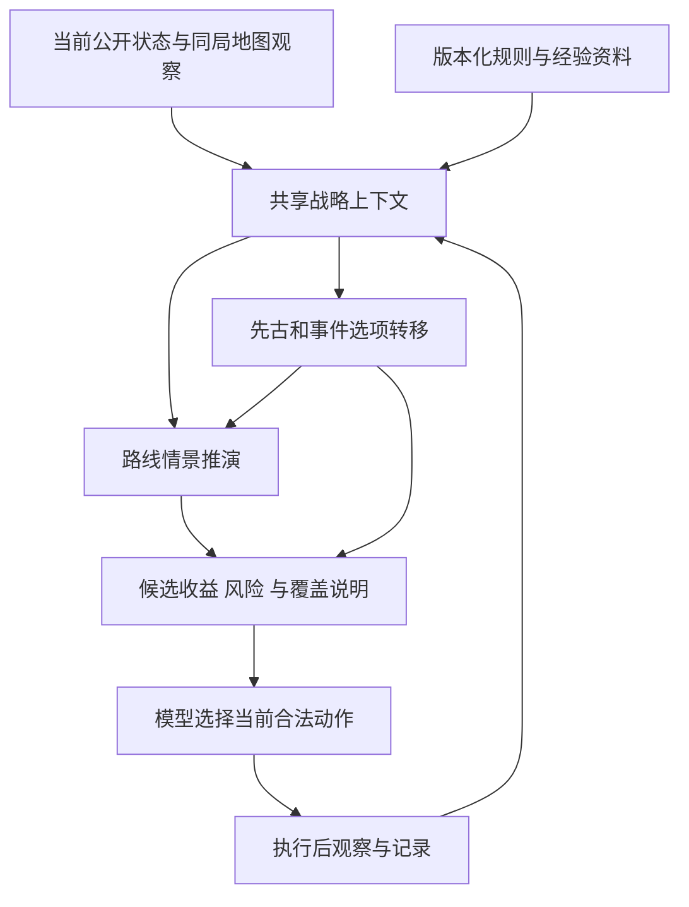

# 路线规划与先古、事件遗物协同建模方案

> 2026-10-20 规则架构补记：后续规则实现按[游戏原生规则独立复刻与全场景迁移实施方案](游戏原生规则独立复刻与全场景迁移实施方案.md)推进。本文的路线、共同价值与验收目标继续保留；旧实体适配、专用效果档案和规则来源建议发生冲突时，以新方案为准。此补记不表示运行代码已迁移。

版本：v0.5 · 状态：讨论稿 · 更新日期：2026-10-18

实施补记（2026-10-18）：已开始首版实现，候选合并、战略上下文、地图缓存、分支资源情景及燃烧之血路线分项已接入；细节、验证和未覆盖范围见[首版实现记录](../reference/路线与战斗协同模型首版实现.md)。下文“尚未实施”等描述保留为讨论稿形成时的基线，不代表补记后的整体状态；其余提案尚未全部实现。

全量范围补记：已取消少量实体 ID 的战略分析入口，注册本机所有 596 张卡牌、299 件遗物、66 种药水及升级版本；状态与完整模拟缺口见[全量效果模型](../reference/全量卡牌遗物药水效果模型.md)。全量注册不等于完整数值估值或精确模拟完成。

代码核对基线：`1701a903af879e72e51afde791b9a3a8acdc2fc3`，当前游戏适配目标为 0.111.0。

本文用于共同讨论改动范围、调优参数与模型调整。以下“拟新增”“建议值”“验收条件”均为设计提案；目前只编写和修订文档，尚未实施对应代码，也没有验证通关率提升。代码现状来自本地源码检查；路线固定评分另做过最小样例计算。

v0.2 已采纳的建模修正：群攻保留为效果的目标覆盖特征，不作为必须补齐的独立能力指标。对多敌人战斗的处理，按敌群关系、胜利条件和可实现的战术过程评估，涵盖单体快速减员、防守等待延迟触发、击杀关键目标和群体伤害等途径。详见第 5.4、6.4、7.5 节及 D16。

v0.3 引入了剩余遭遇机会与针对性投入；v0.4 根据用户澄清，将重点明确为低频、低概率的动态估值。遭遇次数是由路线与规则产生的随机变量，不使用“一次、两次”或“零次/一次/多次”作为固定决策档位，也不设置“低于某个固定概率就忽略”的通用规则。详见第 6.5、7.6 节及 D19、D22。历史版本中的具体次数用于说明问题，不作为建模常量。

v0.5 补充数学模型与跨文档接口：本文负责路线和非战斗选择，[战斗建模草案](战斗决策数学模型共建草案.md)负责具体战斗策略；两层共享继续价值、状态边界和风险口径。重点见第 4.3、5.5～5.8、12.3 节。共同定义、接口与求解方式仍为讨论提案，未修改运行代码或配置。

## 1. 如何使用这份文档

推荐先讨论第 4.3、5.5 节的共同目标与接口，再看第 6～8 节的领域模型和第 13 节待定事项，最后按第 11 节拆分实施。

- 用 `B01` 等编号指代当前问题，用 `D01` 等编号记录设计决定，用 `T01` 等编号指代验收用例。
- 参数由“建议”转为“已确定”时，同时记录理由、适用范围和证据。
- 规则准确性、战略估值准确性、执行结果分别记录，避免把效果已知等同于收益已算准。
- 实施后更新对应状态与验收结果，保留失败场景和适用边界。
- 代码变化后重新核对第 2 节，不把本次基线永久视为当前实现。
- 跨文档引用编号时使用“路线 D23”“战斗 D01”等前缀，两份文档中的相同编号不是同一个决定。

## 2. 已确认的实现现状

| 编号 | 当前实现与证据 | 对决策的影响 | 建议处理 |
|---|---|---|---|
| B01 | [route.py](../../src/python/src/autoslay/evaluation/route.py) 使用固定房间分数；`urgency = 1 + 2 × 缺血比例 + 近期精英/首领修正` | 满血且没有近期危险修正时，篝火 5 分、精英 0 分、普通战斗 0 分、问号 0 分；评分倾向尚未反映打怪成长 | 改为房间转移后的边际收益与风险 |
| B02 | 路线遍历全程沿用同一个 `context.hp`、`context.gold` | 重复高估连续篝火、消费后的商店；无法区分房间顺序 | 每个路线分支维护独立资源状态 |
| B03 | 路线深度优先遍历，最多扩展 500 次，只保留全局前五条完整路径 | 截断时可能受遍历顺序影响，多个候选可能属于同一个当前入口 | 按当前入口分配预算、保留候选，报告搜索完整度 |
| B04 | 路线及部分事件候选返回 `first_action_id`；[options.py](../../src/python/src/autoslay/decision/options.py) 主要读取 `action_id` | 路线分析没有直接绑定到对应可选方案；原始合法动作仍会补入，计算报告也仍可见 | 统一首步绑定，并保留未来路径作为分析资料 |
| B05 | 候选按动作序列去重；`event` 先于 `event_sequence` 加入 | 同一动作的后续事件依据可能未附在候选上；独立报告仍保留该分析 | 合并同一动作的多来源分析，禁止将分数直接相加 |
| B06 | [contracts.py](../../src/python/src/autoslay/agent/contracts.py) 的候选选择提示词单独构造 | 原有关于遗物说明、未估值效果和长期价值的部分指导未进入此分支 | 提取共用决策原则，再附加候选选择约束 |
| B07 | [resources.py](../../src/python/src/autoslay/evaluation/resources.py) 中战后回血仅估一场，开局能量固定 4 分，部分效果使用固定触发次数假设 | 缺少收益期限、牌组适配、限制和路线依赖 | 引入版本化遗物效果档案与情境估值 |
| B08 | [RunContext](../../src/python/src/autoslay/evaluation/run.py) 缺少幕进度、遗物清单和路线摘要；牌组指标以开局资源代理量为主 | 先古、路线、事件之间缺乏统一战略背景 | 新增共享战略上下文，复用现有牌组特征 |
| B09 | [event_adapters.py](../../src/python/src/autoslay/evaluation/event_adapters.py) 的巨花最终遗物分支仍为 `unmodeled_relic_reward` | 有后续事件框架，但部分关键收益仍无法比较 | 优先补充高频事件的完整成本与收益链 |
| B10 | [MapCommands.cs](../../src/csharp/bridge/Commands/MapCommands.cs) 在地图关闭时返回空节点 | 事件内可能缺少已经看过的路线信息 | 缓存本局、本幕、同一地图版本的公开观察 |
| B11 | [EventCommands.cs](../../src/csharp/bridge/Commands/EventCommands.cs) 已提供选项 `relic_id`、悬浮说明和动态数值 | 可复用现有公开数据接入估值，无须先重做事件接口 | 先核查选项身份与档案映射，按缺口补字段 |
| B12 | [agent/context.py](../../src/python/src/autoslay/agent/context.py) 传递最近四条结果；当前跨局策略经验集合为空 | 缺少专门的本幕计划，但已有经验发布基础设施 | 本局计划独立保存，通用经验复用现有审核发布机制 |
| B13 | [contextual.py](../../src/python/src/autoslay/evaluation/contextual.py) 用 `enemy_count` 扩展群体伤害代理量；该分量没有表达目标的召唤/复苏关系或击杀时间 | 静态多目标伤害不能直接说明能否低损通过该敌群；v0.1 将群攻列为能力摘要也过于粗糙 | 效果特征与战术结果分层，按遭遇评估可行应对方式 |
| B14 | [Enemy](../../src/python/src/autoslay/decision/contracts.py) 已有 `minion`；[engine.py](../../src/python/src/autoslay/simulation/engine.py) 在所有非爪牙死亡时设置胜利；当前爪牙身份由公开能力归一化 | 已有部分主要敌人/爪牙终局语义，但单个布尔值不足以表达召唤、复苏、混合敌群和待触发事件 | 复用已支持规则，新增带证据的敌群关系及生命周期适配 |
| B15 | 本地百科中 `RELIC.STONE_CALENDAR` 描述为第 7 回合结束时对所有敌人造成 52 点伤害；当前规则候选标记 `trigger_adapter_required`，生效规则库无该条目 | 已知延迟收益不能等同于已实现跨回合模拟；短窗口可能遗漏核心取胜手段 | 建立触发时间线，补适配前保留已知效果与推演缺口 |

以上说明的是计算和信息组织问题。最终模型仍可结合原始状态作出不同选择，因此不能由这些问题直接断言实战必然选择某条路线。

## 3. 目标、范围与首版交付

### 3.1 决策目标

每个建议需要解释四件事：当前局面的主要短板、选项能解决什么问题、付出什么代价、对下一段路线有什么影响。

“短板”要用具体失败情景说明，例如“无法在第二轮集火前降低压力”，而不是仅根据牌组里没有群攻牌就判断缺乏某项能力。同一问题可以由不同战术解决。

是否需要补这个短板，还取决于本局剩余流程中实际暴露于该问题的机会与代价。允许保留低频、可绕开或能用有限资源承受的弱项，不要求对所有可能敌群都做永久建设。

长期目标是提高稳定通关表现。首版使用可解释的启发式和情景预测，输出名称保持为“收益估计”“风险情景”“覆盖范围”，不将分数解释为真实胜率。

### 3.2 首版建议范围

| 项目 | 首版建议 |
|---|---|
| 决策阶段 | 地图、每幕先古、事件选项；复用篝火与商店能力 |
| 角色范围 | 先覆盖铁甲战士已支持机制；其他角色保留描述与模型判断，单列覆盖 |
| 路线范围 | 当前已公开地图上的短窗口推演，加窗口外摘要 |
| 遗物范围 | 先列完整候选清单，再适配实战出现过且取舍明显的一批；具体数量待清单确定 |
| 事件范围 | 优先有明确代价、遗物奖励或连续选择的高频事件 |
| 决策职责 | 本地生成候选与依据，模型选择当前合法动作，执行后重新观察 |
| 发布节奏 | 基础修复 → 路线与遗物联动 → 本幕计划与校准 |

首版暂缓完整全局随机过程求解、全角色全遗物精确模拟和自动调整生产参数。每一项未覆盖能力都要在候选中保留说明，而不是赋零分。

## 4. 数据与模块关系



遗物选择通过改变状态影响路线评估。路线评估中的单个房间转移使用已取得遗物的效果，避免再次递归启动同一个“遗物选择 → 路线选择”过程。

### 4.1 共享战略上下文

建议新增独立的 `RunStrategicContext`，保留现有 `RunContext` 的兼容入口。字段名称为提案，实施时结合当前协议确定。

| 分组 | 内容 | 来源或约束 |
|---|---|---|
| 身份与进度 | 对局身份、幕索引、楼层、地图版本、角色、进阶 | 以当前快照为准；幕数总量与幕索引分开 |
| 即时资源 | HP、最大 HP、金币、药水、栏位 | 已观察事实 |
| 牌组与遗物 | 牌实例、升级、遗物状态、已支持触发计数 | 保存影响当前策略的细节 |
| 效果与资源特征 | 伤害数值、目标覆盖、费用、抽牌、防御、成长、恢复、延迟触发 | 描述可用手段，不直接转成待补齐的能力分数；保留生效时点与条件 |
| 遭遇应对摘要 | 对代表敌群可实现的减压、关键目标击杀、防守等待及终局方式，附资源代价 | 来源于敌群条件下的战术评估；不压成一个通用“群攻能力”或“多怪能力”分数 |
| 敌群关系与时间线 | 胜利条件、必要目标、召唤/复苏关系、待触发事件、威胁变化 | 具体规则带来源；未知未来状态保留情景与覆盖边界 |
| 剩余遭遇机会 | 各类困难遭遇的条件概率、频率、累计暴露分布、已知必经威胁与可绕行程度 | 随路线、进度、历史与规则更新；概率缺失时保留区间或带前提情景，不固定次数分档 |
| 应对资源与投入 | 永久改善、现有药水、可承受损血、可达恢复、绕行和延后决定 | 临时资源按轨迹消耗；比较长期负担与实际可兑现收益 |
| 改善机会 | 关键升级、删牌候选、当前主要瓶颈 | 来源包括现有选牌/升级评估及有依据的规则 |
| 路线摘要 | 可达节点、恢复点、商店、精英、分岔、公开首领 | 仅使用已公开信息 |
| 收益期限 | 窗口内机会数、窗口外保守/中性/乐观情景 | 估计与事实分开；跨幕地图未知时不虚构具体路径 |
| 本幕计划 | 目标、理由、触发重新评估的条件 | 每项带来源、创建和更新状态 |

### 4.2 地图观察的生命周期

- 地图缓存按对局身份、幕索引和地图 generation 隔离；跨局、跨幕、地图重生成时失效。
- 地图关闭后可复用之前观察过的拓扑；当前位置、血量和库存仍来自最新快照。
- 缓存不保存可复用的行动权限。过去的 `action_id` 不能用于当前执行。
- 当前幕从未观察过地图时，给出“路线信息缺失”，使用明确标注的机会数情景。
- 已公开首领身份只有在可靠映射时才使用；图标缺失不能据此猜出首领。
- 若缓存信息影响分析，它的内容哈希和来源必须进入分析缓存键与离线回放输入。

### 4.3 与战斗建模草案的分工及接口

本方案和[战斗建模草案](战斗决策数学模型共建草案.md)分别描述战略层和战术层。数学细化是对现有方案的补充，领域规则与验收用例继续有效。

| 层次 | 负责问题 | 提供给另一层的内容 |
|---|---|---|
| 战略层：本文 | 路线、先古、事件、资源投入与后续机会 | 当前整局状态、可达路线、恢复/消费机会、共同继续价值与风险版本 |
| 战术层：战斗草案 | 出牌、用药、目标选择、减压与终局方式 | 实际可执行策略下的战后状态联合分布、死亡分支、覆盖与计算误差 |
| 共同基础 | 状态和信息边界、价值单位、终局语义、资源记账、风险口径 | 两层一致使用的模型契约；本文第 5.5～5.8 节集中维护，战斗草案引用并细化战斗侧实现 |

本幕后续压力会影响保留药水的价值；战斗评估则说明保留药水的方案是否能安全完成当前战斗。路线层不能另加一份完整战斗收益，战斗层也不能使用与战略层无关的固定资源价格。

建议的接口字段组如下，正式字段名与协议版本在实施时确定：

| 方向/字段 | 内容与约束 |
|---|---|
| 战略 → 战术：上下文 | 当前资源和牌组、遗物、后续可达机会、公开历史及条件分布；未知遭遇身份不能伪装为当前真实敌人 |
| 战略 → 战术：评价约定 | 继续价值模型、风险规则、预测范围、共同参照与策略版本 |
| 战术 → 战略：结果 | HP、最大 HP、药水库存、金币、永久变化、遗物计数与死亡/胜利状态的联合结果；保留概率或采样身份 |
| 战术 → 战略：未完成部分 | 未建模机制、未知概率质量、搜索截断、尚未结束的战斗与尾部估值来源 |
| 共同边界 | 明确结果位于战后回血之前/之后、奖励领取之前/之后；同一效果只能由一层结算 |
| 共同版本 | 状态协议、价值模型、风险规则、转移规则、后续策略与评估预算；不兼容结果不能直接合并 |

同一次比较固定上下文和价值模型版本，通过有界续打或缓存的尾部估计完成评估，避免路线层与战术层互相无界递归。新观察到来后重新规划。模型请求和离线回放都需保存上述接口所使用的输入。

例如历石：战术层评估能否撑到触发、等待与收尾的代价；战略层评估相关遭遇的暴露分布、获取历石的代价和替代选项。两层传递条件化结果，不把各自的独立分数相加。

## 5. 共同估值原则

### 5.1 状态改变优先，统一比较期限

设决策状态为 `x`（包含公开状态与条件信息，见第 5.5 节），当前行动为 `a`，可执行后续策略为 `π`。建议优先采用终点价值的统一账本：

```text
Q_H^π(x, a)
  = E[Φ(X_τ) | x, a, π] - V_ref(x)

候选边际收益 ΔQ(a, a_ref)
  = Q_H^{π_a}(x, a) - Q_H^{π_ref}(x, a_ref)
```

`τ` 是声明的预测截止或更早发生的整局终止时点。资源变化进入状态；`Φ` 评估结束或继续这局游戏的价值，其具体含义见第 5.5 节。`V_ref(x)` 对当前所有候选相同，只用于解释相对值，不改变排名。若另采用逐步奖励，必须与剩余价值形成一致账本，不能再叠加已经计入终点的资源。

参照选择 `a_ref` 必须明确：例如事件的离开、先古的另一选项、地图的另一个入口。不存在合法离开选项时直接比较合法选项；假想状态只用于解释，不成为可执行动作。

同组比较采用一致的目标、单位和价值模型版本。首轮实验使用可比较的预算与截止口径；扩展到关键事件时允许实际展开长度不同，但尾部必须回到相同的继续价值语义。现有战斗分、牌组分与遗物时机分不能未经换算直接相加；首版对无法统一的分量分栏展示。

### 5.2 避免重复计分

| 收益/代价 | 计算约定 |
|---|---|
| 战后回血 | 已改变后续 HP 时，不再额外加一次完整回血价值 |
| 金币奖励 | 已进入库存价值时，不再重复添加同额奖励分 |
| 商店消费 | 同时更新金币与所得资源；未来商店按新库存评估 |
| 升级 | 已改变牌组后，避免在“获得升级”和“升级后牌组”中重复奖励 |
| 遗物长期效果 | 窗口内触发更新状态；终点评估当前资源与后续效果，不另加已结算触发的收益 |
| 被迫回血 | 若已经通过篝火分支体现放弃升级，就不再扣同一笔升级机会成本 |

每个分量应记录计入位置、期限及规则版本，便于检查。

### 5.3 风险与未知量

- 游戏明确标记的致死效果，或完整确定规则推导的致死结果，单独标注并优先避免；若所有选择都有风险，仍保留完整比较。
- 未知战斗的悲观损血属于情景，不能直接当成确定致死而删除候选。
- 有可靠概率时才计算期望；没有概率时展示多个情景及排名是否稳定，不默认给三种情景各三分之一概率。
- 如果某选项在所有已建模情景中都更好，可以给出“情景内稳健占优”；情景交叉时展示收益与风险取舍。
- 覆盖不完整时保留已知分项和缺失内容，不用“未知罚分”悄悄替代未建模收益。
- 同时报告机制覆盖和搜索覆盖。二者不能互相代替，也不能直接解释为预测置信概率。
- 将“遇到后的严重程度”与“剩余流程中遇到的机会”分开。低频不自动忽略，高损情景也不能自动视为每条路线必遇；风险偏好见 D03。

### 5.4 从效果特征到战术结果

单体伤害、群体伤害、防御、抽牌和能量是可用手段。它们的实际价值取决于面对什么敌群、在什么时间生效、是否能组织成可执行的应对方式。群攻不能成为独立的必备项，也不能仅改名为“多敌人能力”后继续用一个固定分数评估。

建议分为三层：

| 层次 | 描述内容 | 例子 |
|---|---|---|
| 效果层 | 对谁、在何时、以何种条件产生什么效果 | 集中伤害、所有敌人伤害、格挡、历石延迟触发 |
| 遭遇层 | 敌人之间的关系、威胁进程和胜利条件 | 独立敌人、可复苏爪牙、召唤源、主要目标死亡后终局 |
| 战术层 | 当前资源如何在该遭遇中组合成可行过程 | 首轮斩杀减员、压制爪牙争取时间、集火主要目标、防守至遗物触发 |

战斗代价的评估单位建议采用“当前局面 × 遭遇情景 × 可行战术”；战略投入在此基础上再结合遭遇次数与路线机会，见第 6.5 节。输出至少保留以下结果，允许不同方案各有优势：

- **压力何时下降**：下一个危险行动前能否减员、暂时压制或结束战斗；减压能持续多久。
- **能否撑到关键时点**：考虑逐回合伤害、状态、资源和抽牌可达性，不能只用平均格挡乘回合数。
- **何时满足胜利条件**：区分必要目标与非必要目标，处理复苏、再召唤及阶段转换。
- **实际代价与稳定性**：路径中的 HP 最低点、总损血、药水消耗、关键牌依赖和失败情景。

伤害本身不自动等于收益。对即将复苏的爪牙造成伤害，可能只有暂时减压价值；对无需击杀的爪牙造成伤害，可能不推进终局；群体伤害的过量部分不能继续按满额计分。相应地，临时清掉爪牙能阻止高额伤害时，也不能因为“会复苏”而一概视为浪费。

在多种战术的代价接近时保留替代方案，避免预先强制“必须有群攻”“必须尽快击杀”或“有历石就应拖回合”。资源、抽牌和未知分支必须沿同一条可达轨迹计算，不能把一条轨迹的输出与另一条轨迹的防御拼接成理想方案。

### 5.5 共同继续价值与状态转移模型

长期目标建议表述为在已知信息下提高整局通关概率，但首版的资源代理值不能标为已校准的通关概率。具体风险偏好仍需共同决定；“当前房间风险最小”不自动等于“整局通关机会最大”。

建议使用 `x=(s,b)` 表示决策输入：`s` 为已公开的整局状态，`b` 为依据公开历史形成的隐藏事件条件分布。战斗中另保留手牌、牌堆、敌人、待触发效果和阶段等细节。概率未知时保留集合、范围或缺失标记；不要求先实现通用 POMDP 求解器，也不把主观计划当成已知游戏事实。

共同继续价值记为 `V̂_run(x; θ)`，`θ` 包含资源代理、终值和后续策略的版本。其语义是从 `x` 继续作可执行决策后的整局价值。候选共享以下终点定义：

```text
Φ(x) = U_death                     已死亡
     = U_clear                     已完成本局目标
     = V̂_run(x; θ)                存活且位于非战斗决策边界
     = V̂_continue(x; θ)           战斗/事件尚未结束，使用同单位的续算价值
```

`U_death`、`U_clear` 与代理值采用同一尺度，具体取值待讨论；在战斗草案中 `-C_death` 对应这里的 `U_death`。若以后改用校准过的通关概率，应整体改为相应的终局语义，不沿用代理分数的死亡常量。有限续算不是精确最优值，必须声明所用后续策略及其覆盖。

一场已知遭遇 `e` 在可执行战术 `π` 下，返回结果分布 `K_e^π(x' | x)`。死亡保留为吸收结果；无法继续的未知分支单独记录，而不是删除后把剩余概率归一化。跨房间规划使用这些结果推进资源与条件信息。

必须保持 HP、药水、金币、遗物计数等结果的关联。一般有 `E[V̂_run(X')] ≠ V̂_run(E[X'])`；“高血量但药水已用”和“低血量但药水保留”不能替换为虚构的平均状态。战后回血与奖励边界按第 4.3 节约定处理，未来尚未公开的奖励仍是随机结果或未覆盖部分。

继续价值的建议实现顺序：先统一现有资源代理与账本，再用有界、合法的后续策略生成可复现的估值参考；样本足够后才考虑拟合快速近似。真实执行记录用于核对规则和校准，高预算模拟只作为同模型下的计算参考。模型训练、校准和验证按对局及来源分组，不承诺已有数据足以预测真实胜率。

### 5.6 信息约束与可执行策略

后续策略必须是已观察历史的函数。模拟中尚未揭示的信息不能提前影响购药、选牌或选路；揭示后可以重新选择。相同观察历史下的行动必须一致。

```text
可执行策略的目标：  max_π E_ω[U(π, ω)]
预知未来的上界：    E_ω[max_π U(π, ω)]
```

前者中的策略只能使用当时已知信息；后者允许针对每条完整未来另选策略，一般更乐观，不能当作可实现收益。比如进房前购药要对未揭示敌群共用一个决定，进房看见敌人后可以选不同战术。

搜索应区分决策节点、随机节点和信息揭示节点；缓存与状态合并也要保留条件信息和待结算效果。分岔的价值来自未来获得信息后可转向的行动机会，不能同时收取互斥路线的好处。这个约束同时适用于路线、事件与战斗抽牌。

### 5.7 非线性边际价值与尾部估计

新增卡牌、遗物、金币或防御的价值由改变后的整个局面评估。额外防御可能让等待历石成为可行策略，额外金币可能使关键购买可行；能量与抽牌可能互补。不能把这些相互依赖的变化固定拆成独立加分，再额外重复奖励协同。

禁止固定遭遇次数阈值并不意味着价值函数必须线性，或最终离散选择不能变化。选择改变应来自当前状态下的收益交叉、真实资源门槛或合法动作变化，而不是人为的“一次/两次”分档。

预测窗口优先覆盖可能改变排序的事件，如遗物触发、关键恢复、升级或首领；未展开部分仍使用同单位的继续价值。建议首版不对时间本身机械折扣（`γ=1`），拖延造成的损血、敌人成长和资源消耗通过转移体现。若要对游玩耗时定价，应另行明确目标并实验，而不是把慢启动方案统一降分。收益兑现机会与不确定性依然要计算，不能把不折扣理解为保证未来收益。

### 5.8 风险口径与三类不确定性

两层共用一个有版本的风险规则。战斗草案中的死亡风险优先、风险预算约束、统一期望效用等方案均为待讨论选项；不能在路线层使用一种排序，战斗层未经声明改用另一种。若增加尾部损失项，需要检查它与死亡后果、非线性生命效用的重复影响。

| 不确定性 | 表达与处理 |
|---|---|
| 游戏随机性 | 使用有依据的概率分支或正确采样，保留结果分布 |
| 规则或概率参数未知 | 补机制资料、记录参数区间与适用范围，分析结论敏感性 |
| 搜索或采样不足 | 记录预算、覆盖和估计误差，对可能改变选择的候选追加计算 |

增加样本不能修复漏算的遗物；低资料置信度也不能直接解释为高死亡率。风险须声明范围：当前动作、整场战斗或整局。不能把相同局部死亡率预算机械地分配给每个房间；也不能删除死亡分支后只比较存活者资源。

滚动重规划使用根节点整条轨迹风险还是嵌套风险，需要共同确定，二者不能默认等价。若现阶段只能做情景比较，就保留该身份，不编造概率上界或风险预算已经满足的结论。

## 6. 路线模型

### 6.1 分支状态与房间转移

每条路径分支维护独立的 HP、最大 HP、金币、药水、牌组变化、遗物触发状态和估计标签。未知奖励可以保留机会或收益区间，不能生成假想的具体卡牌或遗物实例。

| 房间 | 首版转移 | 主要建模点 |
|---|---|---|
| 普通战斗 | 对有依据的遭遇情景比较可行战术，估计损血、药水与收益机会，应用已支持战后效果 | 根据幕、进阶、敌群关系、当前资源及战斗策略版本评估；不能仅由 HP、敌人数或群攻牌数量判断战力 |
| 精英 | 单独的遭遇压力、关键时点与奖励机会 | 目标优先级、可否快速减压或低损等待、连续作战、药水补强、精英前升级 |
| 篝火 | 在可用行动中比较回血、升级及已适配的其他选项 | 回血受上限约束；升级具体到实例；遗物禁止的行动不可出现 |
| 商店 | 对可见库存精确使用现有组合搜索；未来未知库存使用预算情景 | 消费前后金币一致；预留金币必须有可达消费机会依据 |
| 问号 | 使用有依据的结果分布，或明确的无概率情景 | 不将所有问号当作相同的零收益，也不猜当前房间的隐藏内容 |
| 宝箱 | 使用已知的奖励与代价规则 | 未知奖励身份保留为未知；当前可见选择逐项比较 |
| 首领 | 公开身份可用于能力缺口评估 | 实际首领胜率不能由固定房间分数推出 |
| 先古 | 地图阶段只视为后续选择机会；进入事件后按真实选项估值 | 不预选尚未公开的遗物 |

### 6.2 搜索方式

建议使用按当前入口分组的有界束搜索：

1. 从当前合法可达节点建立入口，每个入口都有预算和最低覆盖保障。
2. 每次扩展房间，产生资源转移及必要的情景分支。
3. 按资源状态、收益与风险保留不同代表路径，避免把所有名额用于同一类结果。
4. 到达窗口末尾后使用共同终点价值，包含当前资源与后续机会；窗口内已进入资源状态的收益不再额外累加。
5. 每个入口输出收益路径、保守路径及可能的转向点；只绑定当前一步。
6. 实际走完一个节点后，用真实结果重新分析。

初始讨论参数：前看 4 个节点、每个入口保留 8 个代表状态。它们只是起点，需用耗时、截断和建议稳定性共同确定。

节点扩展采用稳定顺序与明确的预算分配。预算不足以覆盖所有入口时，将未展开入口标为未评估，不能按差路径处理。全局展示可以精简，但模型可选动作不因此丢失。

在最低覆盖之后，建议根据候选分差、估计不确定性与继续计算可能改变选择的程度分配追加预算。束宽和展开深度是计算资源参数，不是策略上的固定次数阈值；同节点但不同牌组、资源、遗物状态或条件信息不能随意合并。

束搜索可以筛选可选策略，但不能把随机节点中不利结果删掉，只保留有利结果。随机分支截断必须保留未覆盖质量或使用有正确权重的近似。对低概率高损分支可专项采样，但要恢复目标分布的权重；候选配对评估也需保持各自边际分布正确，不能强行让不同路线遇到相同怪物。

误差区间成立时可以据此提前停止无望候选的计算；启发式范围与未知规则缺口不能充当最优性证明。实际耗时、扩展数、尾部估值调用和候选顺序敏感性均需记录。

### 6.3 分岔与转向价值

分岔价值来自“获得新信息后能够选择不同后续路线”。第一阶段在报告中展示这一能力；数值化时通过条件分支体现，不简单按分岔数量加分。

例如，一条路径在下一场战斗后可以选择精英或篝火，其价值取决于战后 HP 和奖励是否足以支撑精英。不能事先同时把精英奖励与篝火回血都算入同一条轨迹。

### 6.4 从敌群结构估计战斗代价

地图上的 `Monster` 或 `Elite` 只是房间类型，无法直接给出战斗代价。建议由独立的遭遇评估模块生成房间代价情景；实际敌人未知时，只使用有来源的适用遭遇集合或代表情景，不读取隐藏生成结果，也不默认各类敌群等概率。

敌群档案至少描述：敌人角色与关系、是否必须击杀、召唤来源及条件、复苏条件与时点、敌方成长或其他拖延代价、行动阶段、战斗结束判定。角色可以组合，不能假定“有召唤能力”就一定“杀召唤者立即结束”。

| 敌群结构 | 必须区分的结果 | 候选应对方式 |
|---|---|---|
| 相互独立且都需击杀的多敌人 | 减员后压力持续下降，剩余目标仍需处理 | 单体逐个斩杀、群体伤害，或防守等待共同削血后收尾 |
| 可重复召唤或复苏的敌群 | 击杀爪牙通常只暂时减压；新一轮威胁按真实规则恢复 | 压制高威胁爪牙争取窗口、优先处理来源，或在再生前完成终局 |
| 主要目标死亡即可结束的敌群 | 满足经验证的结束条件后，无需额外清理附属目标 | 直接集火主要目标，或先临时减压再集火 |
| 多个主要目标、混合或阶段转换敌群 | 存活主要目标、待复苏/转换事件和终局关系需要联合判断 | 分阶段选择目标，重新评估永久与临时减压 |
| 关系尚未适配的敌群 | 名称、数量或外观不能证明胜利条件 | 保留公开规则与不同情景，报告结构缺口 |

核心计算应随战术更新“未来威胁时间线”：杀掉独立敌人后移除其后续行动；临时击杀爪牙后仅移除恢复前的行动；主要目标死亡后按真实规则检查战斗结束；不结束时继续处理剩余角色和待触发事件。总敌人 HP 和当前活敌数量只能作为辅助信息。

路线候选使用各遭遇下实际可达的战术代价。若某条路线仅在一类敌群下存在明显困难，应说明那类敌群与失败原因，不能输出笼统的“缺群攻，所以避战”。选牌、先古和事件遗物则比较取得选项前后，这些困难情景是否改善。

首版先做有限敌群档案和少量有依据的战术模板，复杂情况明确退回模型解释。路线前看 4 个节点与战斗前看若干回合是不同预算；没有展开到关键战斗事件时，不能将该事件的收益计为零。

### 6.5 遭遇概率、频率与针对性投入

某类敌群存在且当前牌组处理吃力，只说明存在一个条件性问题。是否值得补牌、升级或选择专用遗物，还要看剩余流程中有多少机会碰到，以及其他解法的代价。

这里的“困难类型”按当前资源与战术定义，只用于解释与报告，不作为底层生成概率的实体。例如已有单体减员或历石等待方案时，一部分多敌人遭遇可能已不再困难，但这些敌群的原始出现概率未必改变。不能把“多敌人房间次数”直接当成“需要群攻的次数”。

底层分开维护原始遭遇分布 `P(e | 公开历史, 节点与适用规则)`、条件战斗结果 `K_e^π` 和后续路线策略。牌组改善通常改变战斗结果；除非有已验证的游戏机制，不直接改变同一生成条件下的敌群概率。路线变化可以间接改变累计暴露。困难标签与次数从这些模型派生，避免同时降低“困难频率”和“单场损失”而重复计算同一改善；低频也不再额外乘一个主观罕见度折扣。

#### 6.5.1 按路线估计条件分布

建议先构建原始遭遇与资源演变的条件分布，再按困难类型 `c` 派生剩余暴露摘要。`N_c` 表示轨迹中被归入该类型的遭遇次数，其取值范围由剩余路线和规则决定；报告需注明类型的判定条件。条件信息包括已公开状态 `I`、适用的历史与生成规则，以及允许后续根据真实观察转向的路线策略 `Π`。

区分“出现机会少”和“每次机会的发生概率低”：两者都可能降低针对性投入的收益，但剩余机会很多时，较低的单次发生概率仍可能累计为明显暴露。不能只看某个节点的概率或只看平均次数。

| 项目 | 含义与来源要求 |
|---|---|
| `P(N_c > 0 ∣ I, Π)` | 在所评估范围内至少遭遇该问题的机会，区别于单个节点的发生概率 |
| `E[N_c ∣ I, Π]` | 同一范围内的预计遭遇次数，作为频率与暴露量摘要；不能单独替代完整分布 |
| `N_c` 的可行范围 | 来自可达房间与已验证规则；不人为限制为几个固定次数档位 |
| `P(N_c = n ∣ I, Π)` | 只有有依据的生成模型或经过说明的经验估计时才提供，附来源和适用范围 |
| 时序与依赖 | 遭遇出现的阶段、连续性、与补给机会的关系，以及不同节点之间的依赖 |
| 必经与可选威胁 | 已公开且不可绕过的首领等，和可通过路线减少的遭遇机会分开 |
| 暴露时间与准备窗口 | 威胁可能出现在下一次补给前，还是有机会等到新信息后再准备 |
| 范围 | 本幕、已知后续节点或整局情景；本幕零次不等于后续幕也零次 |

遭遇池、重复限制、抽取是否有放回、早期与后期房间规则等，需要核对对应游戏版本才能使用。已经打过某种敌群不自动意味着不会再遇到；各节点也不默认独立同分布。问号转战斗、事件强制战斗等可能来源应在规则支持范围内计入，缺失时说明范围不完整。

没有可靠概率时，提供有依据的分布范围、概率区间或带前提的代表轨迹，说明建议的敏感性。代表轨迹随可行范围和预算选取，不固定为零次、一次、多次三档；规则排除的轨迹不能参与比较。未知概率既不能默认平均分配，也不能当成零。

不设置“预计次数不超过某个常量就不补强”或“概率低于某个固定百分比就忽略”的全局规则。投入是否划算由完整收益、代价与失败后果决定。实际药水使用次数、遭遇生成限制等经核实的游戏规则仍需遵守，它们与人为设置的策略分档不同。

#### 6.5.2 比较完整的应对组合

| 应对方式 | 需要计算的收益与代价 |
|---|---|
| 永久加牌、升级或遗物 | 改善哪些实际遭遇，同时计算金币、升级机会、抽牌/费用负担与放弃的其他选择；遗物也可能提供更广泛收益 |
| 现有药水或其他有限资源 | 能覆盖几次，可能在哪次提前消耗，留给其他战斗的价值及栏位占用 |
| 接受可承受的损血 | 整条轨迹的 HP 低点、累积战斗压力、恢复条件及放弃升级等机会成本 |
| 调整路线 | 减少困难遭遇机会，同时计入绕行放弃的奖励、商店或升级机会；节点身份未知时只能降低暴露，不能保证避开 |
| 延后决定 | 新信息能否在威胁前到来，届时是否仍有合法改善机会；不能保证未来一定刷出所需卡牌、药水或商店库存 |
| 暂不补强 | 用已有战术承受剩余风险，并明确哪些情景会失败或造成高损 |

消耗型药水应按实际机制沿轨迹扣除，不能在后续每场候选战斗中都重复当作可用，也不能假定消耗后必然补回。损血和药水都不是免费替代品；当困难的发生概率或暴露频率较低、临时资源有足够覆盖能力时，它们可能比长期改变牌组更划算。是否足够由资源状态与遭遇分布共同判断。

#### 6.5.3 将频率与后果一起计入收益

有可靠次数分布时，可用下式解释某项改动的针对性收益：

```text
针对类型 c 的收益
  = Σ_n P(N_c = n ∣ I, Π)
      × 在该次数情景下、按可行战术实际减少的代价
```

这里的求和覆盖该模型所有可行的 `n`，不只枚举几个固定数字。次数相同仍可能有不同顺序、抽牌和资源轨迹，“实际减少的代价”还需在对应条件分支内评估。若使用采样或预算截断，报告代表方式与未覆盖部分。

这是分项解释，不是把所有威胁独立求和的总评分公式。同一场战斗可能属于多个困难类型，不能重复计收益；资源消耗、HP 变化和后续路径必须连续计算。只有在单次收益近似不变、没有资源枯竭或交互时，才可简化为“平均次数 × 单次收益”。

零次情景中，该威胁专属收益为零，但选项在其他战斗或长期发展中的收益和负担仍要计入。专用牌可能在多数其他战斗里占用抽牌与能量；即使这张牌免费获取，长期成本也不一定为零。反之，一项改善若兼顾多种常见问题，也不能只按某一种罕见敌群的出现次数估值。

完整比较使用第 5.1 节的状态价值：分别计算取得选项和参照选择后可行的路线与战术。强力选项可能解锁更有收益的路线，不能用旧路线固定的次数分布评价全部候选。路线策略只能根据届时已经观察到的信息调整，不能预知隐藏怪物后再选择走法。

低频但可能终结对局的风险需要单独列出，不能只用平均损血将其稀释。可以比较现有药水保险、避开额外战斗、低成本通用补强等方式；没有可用应对且失败后果严重时，永久补强仍可能值得。具体风险阈值保持为待校准参数。

#### 6.5.4 代表性决策情景

以下是定性的模型验收方向，不定义次数档位或固定概率阈值，也不是对当前游戏概率的断言。

| 情景 | 模型应支持的结论 |
|---|---|
| 已有依据证明剩余流程不会出现该困难 | 不为该困难额外奖励专用选项；仍检查通用收益与其他幕的适用范围 |
| 发生概率或暴露频率较低，现有资源有足够覆盖能力 | 可以保留弱项，使用药水、既有战术或可承受损血，不必永久改牌组 |
| 发生机会较小，但一旦遇到代价很高 | 比较发生机会、失败后果和保险成本，不能仅凭“运气好可跳过”忽略风险 |
| 预计暴露增加，临时资源耗尽风险上升 | 后续代价上升，重复可用的改善可能更有价值 |
| 绕行可降低暴露，但会失去较多成长 | 比较绕行与补强后继续获取成长的完整路线 |
| 已经通过相关阶段，或规则允许公开历史改变后续分布 | 更新专用选项价值与本幕计划，不沿用开幕时的短板目标 |

计划每次更新都需要重新核对剩余次数与准备窗口。曾经需要解决的问题可能已经过期，也可能因路线改变重新重要。

## 7. 先古与遗物模型

### 7.1 规则档案与战略估值分层

建议为首批遗物建立如下档案。目录与字段在实施时纳入现有知识库 manifest、校验和版本管理。

| 档案内容 | 用途 |
|---|---|
| 实体 ID、游戏版本、源码/描述指纹 | 确认适配对象与规则版本 |
| 生效时点、触发条件、触发次数限制 | 决定何时能兑现收益 |
| 资源或能力变化 | 改变能量、抽牌、回血、经济、升级等状态 |
| 限制、副作用、替换或失去的能力 | 完整计算代价 |
| 与已拥有卡牌/遗物的相关交互 | 避免只看孤立强度 |
| 已支持规则、未支持交互与证据 | 决定能否完整比较 |
| 估值方法与校准版本 | 区分精确规则、代理量和实战估计 |

规则档案说明“实际发生什么”；估值器说明“在这个局面值多少”。固定强度表只能作为明确标注的参考，不能代替边际分析。

### 7.2 按效果与资源类型估值

| 类型 | 关键变量 | 需要防止的误判 |
|---|---|---|
| 能量 | 能量需求、抽牌、可打牌密度、生效回合 | 有能量但无牌可打，仍按满收益计分 |
| 抽牌 | 能量、费用结构、手牌容量、禁止抽牌效果 | 抽到牌却打不出；忽视满手或限制 |
| 回血/减伤 | 预计受伤、触发频率、HP 上限、后续恢复点 | 满血溢出；将一场收益误当整局收益 |
| 战斗成长 | 启动时间、战斗长度、攻击/防御配合 | 把战斗内成长当作跨战斗永久成长 |
| 延迟伤害/阶段触发 | 触发回合与阶段、等待过程中的压力、触发后剩余必要目标 | 短窗口遗漏收益，或未检验生存与触发顺序就认定能安全等待 |
| 经济 | 剩余触发机会、可达商店、可花费时间 | 临近结束仍按早期收益期限计分 |
| 升级/删牌 | 实际目标、剩余可改善牌、触发条件 | 无有效目标仍计满收益 |
| 规则改变 | 被改变的合法动作、资源机制、核心组件 | 只计算收益，忽略对牌组运转的破坏 |

对尚未逐次推演的重复效果，可以用“有效触发次数 × 单次边际收益”作为局部近似，但有效触发次数必须扣除溢出、触发限制和期限；不能把这个近似再叠加到已经逐次推演的同一段收益上。

### 7.3 各幕的差异

| 阶段 | 默认关注点 | 覆盖默认倾向的实际信息 |
|---|---|---|
| 第一幕 | 早期战力、较早启动的持续成长、较长收益期限 | 即将遭遇的压力、当前牌组、可达路线 |
| 第二幕 | 已形成牌组面对适用敌群时的失败情景，以及减压、防守、运转和终局方式 | 单体快速减员或低损等待已能解决问题时，不机械要求补群攻 |
| 第三幕 | 公开首领要求、启动稳定性、收益能否及时兑现 | 剩余节点、当前资源及真正未解决的问题 |

幕数是上下文，不能直接变成“这一幕某类遗物永远最高分”的硬编码规则。

### 7.4 首批覆盖清单模板

具体实体待从本地规则与实战记录整理后填写，不在讨论稿中编造排名或覆盖数量。

| 实体/选项 | 出现场景与幕 | 即时收益/代价 | 长期触发 | 关键交互 | 证据 | 支持状态 | 关联用例 |
|---|---|---|---|---|---|---|---|
| 待整理 | 待整理 | 待核对 | 待核对 | 待核对 | 待关联 | 未开始 | 待关联 |

优先级建议按“实际出现频率、选择分歧、潜在损失、适配成本”共同决定，不仅按遗物稀有度排序。

### 7.5 历石示例：防守与延迟输出的联合价值

用户提出的历石场景用于说明建模原则：牌组可以通过高防御低损撑到遗物触发来处理多敌人。当前本地百科描述为“第 7 回合结束时，对所有敌人造成 52 点伤害”；具体触发阶段、伤害修正、死亡与召唤交互仍需规则适配核对。当前生效规则库尚无该遗物的可用适配，不能宣称已能精确模拟。

需要将“快速结束”“先减压再等待”“持续防守等待触发”等可行方案放在同一遭遇下比较：

1. 从当前回合与阶段定位触发时点，不能把回合结束效果提前到回合开始，也不能无依据认定触发前已承受或无需承受某次敌方行动。
2. 沿等待轨迹检查可用手牌、能量、洗牌/抽牌、防御和药水，记录 HP 低点及新增状态。
3. 处理敌方成长、召唤、复苏、塞牌或其他拖延代价，判断低损等待是否真实可行。
4. 到触发时仅作用于实际存在且受效果影响的目标，并处理格挡、免疫或伤害修正等已支持规则。
5. 重新判断胜利条件；必要目标没有被清除时继续估计收尾代价，不能把触发等同于获胜。
6. 已有更快且代价更低的终局路径时，不为兑现遗物效果额外拖延；已有稳定等待方案时，也不因缺少群攻牌直接判定有短板。

延迟触发应作为战斗预测的关键时点。预算允许时扩展到该时点及必要收尾；无法展开时保留其已知效果、到达条件与未覆盖区间，不能无条件兑现，也不能因位于短窗口之外而归零。首版可提供带前提的等待情景，不能假装已算出完整七回合行动序列。

取得新遗物或卡牌的收益，体现在这些战术的可行性和资源代价如何改变。例如增加防御可能让等待历石成为低损路径，新增群体伤害也可能缩短等待；二者应按实际改善比较，不预设某一类手段必需。

### 7.6 专用选项的回本条件

先古、事件、选牌和商店中的针对性选项，都需要说明其受益场景的发生概率、剩余暴露频率、可替代的资源及其他通用收益。

- 当专用改善的概率加权收益不足以抵消投入与持续负担时，允许选择通用收益或跳过；不按固定次数阈值决定。
- 展示投入收益对遭遇概率、暴露频率及实际代价的敏感性；可以解释回本条件，但该条件由当前局面推导，不是全局常量。
- “回本”包括风险改善、资源节省和新路线机会，不能只折成伤害或金币。
- 专用选项带来的额外抽牌负担、费用需求、升级占用或获取代价，与所有后续战斗共同估计。
- 若新选项让更高收益的路线可行，应把这部分收益纳入，同时使用新路线对应的遭遇机会。

首批报告展示条件概率或区间、暴露量摘要、收益与代价分解及结论翻转条件，不要求固定的次数分档。具体概率未经核实时，不合成伪精确总分。

## 8. 事件交易与后续选择

复用 [events.py](../../src/python/src/autoslay/evaluation/events.py)、[event_sequences.py](../../src/python/src/autoslay/evaluation/event_sequences.py) 和来源适配器，将事件选项转成有顺序的状态变化。

1. 绑定当前阶段、选项身份、动态数值和奖励对象。
2. 按真实顺序应用扣血、扣金币、增减最大 HP、加牌、删牌、升级、获得遗物等效果。
3. 应用已支持的现有遗物交互及新遗物的获取效果；单纯看到 `relic_id` 不能认定选项只有“获得遗物”。
4. 连续选择继续推演到已知终点或预算边界；随机概率必须有规则依据。
5. 用改变后的状态评估后续路线，并与其他当前选择比较。
6. 进入随机结果、卡牌选择器或其他子界面后，真实执行读取新状态再决策。

| 交易类型 | 需要计入的后续影响 |
|---|---|
| 扣血换遗物 | 下一战安全余量、药水需求、是否改变篝火选择 |
| 诅咒换遗物 | 删掉之前的负担、可达删牌机会、费用以及替代删牌目标 |
| 扣最大 HP | 当前 HP 的钳制、后续恢复容量、明确的触发效果 |
| 金币换收益 | 当前交易价值和未来消费机会，不只套固定金币换算 |
| 升级/变牌/删牌 | 具体实例、合法目标、随机池及新牌组价值 |
| 连续冒险 | 每一步新增收益与下一步风险，允许及时退出 |

未知分支不强制产生总分。报告应列出“已知成本”“已知收益”“未估值部分”和“后续选择”，让模型有足够信息比较。

## 9. 本幕计划、候选报告与可观察性

### 9.1 本幕计划

建议保存结构化目标与简短说明，例如“下个精英前完成某张牌的升级”“金币优先留给可达商店”。每项记录依据、适用状态和失效条件。

针对战斗的计划应描述失败情景与目标，例如“在下一次再召唤前处理主要目标”“降低等待延迟触发期间的损血”。已有其他有效解法时，不生成无依据的“必须补群攻”目标。

每个补强目标同时记录适用敌群、剩余遭遇机会、准备截止点和替代手段。目标可因威胁阶段结束、路线绕开或现有资源足够而取消；不能在预计已无使用机会时继续追求专用组件。

新幕、核心牌/遗物变化、路线变化、关键升级完成、HP 或药水偏离预期时重新评估。计划应能被新事实修正，不能因持久化而覆盖当前明确更好的选择。

计划按对局身份保存，并能由归档重建。策略经验继续通过 [experience.py](../../src/python/src/autoslay/knowledge_base/experience.py) 管理；临时计划不直接写入跨局知识。

### 9.2 候选报告建议字段

| 字段组 | 内容 |
|---|---|
| 当前操作 | 候选 ID、当前合法首步、目标；未来路径不具执行权限 |
| 多来源依据 | 路线、事件即时效果、事件后续、遗物估值分别保存 |
| 状态变化 | HP、金币、药水、牌组、遗物及路线机会的变化 |
| 收益分解 | 即时、窗口内及后续机会的贡献说明；注明单位、期限、依据与记账位置，不把终点资源和已计入其中的收益相加 |
| 风险 | 确定风险、情景风险、不同情景下建议是否一致 |
| 覆盖 | 未建模机制、缺失输入、搜索截断和未展开入口 |
| 战略解释 | 解决哪个短板、放弃什么、什么变化会推翻当前建议 |
| 遭遇与战术 | 敌群关系、胜利条件、关键时点、可行解法及被排除解法的原因 |
| 暴露与投入 | 条件概率或区间、预计暴露及分布、来源与范围、必经/可选威胁、临时方案、敏感性及绕行代价 |
| 复现信息 | 状态/知识/参数/模型版本、地图观察摘要、计划版本 |

展示时先说明当前推荐与关键取舍，再展示数值。多个评估器支持同一操作时，合并依据而非重复加分。预算不足时优先保留合法动作、选项完整效果和关键未知项。

## 10. 模块改动清单

以下新增模块名为建议，具体拆分可在实施前调整。

| 模块 | 改动 | 依赖 |
|---|---|---|
| `decision/options.py` | 首步 ID 兼容、同动作多来源依据合并、完整合法候选保留 | 第一批即可开展 |
| `agent/contracts.py` | 共用战略解释规则，接入候选选择分支 | 第一批即可开展 |
| 拟新增 `evaluation/run_context.py` | 效果特征、遭遇应对摘要、来源、失败情景与机会期限 | 当前状态、现有牌组特征与遭遇评估 |
| 拟新增遭遇评估模块 | 敌群关系、战术模板、威胁时间线、条件性战斗代价 | 公开怪物规则、状态转移、遗物关键时点 |
| 拟新增遭遇机会模型 | 条件化于路线、进度和公开历史的遭遇概率、频率与暴露分布；保留时序、范围和来源 | 已核对规则或标注范围的统计；不读取未来隐藏结果，不设置固定次数档位 |
| 拟新增共同价值与转移接口 | `V̂_run`、终局/尾部语义、战后联合结果、概率质量及版本兼容 | 本文第 4.3、5.5～5.8 节；战斗草案第 3.4 节 |
| 拟新增地图观察存储 | 同局公开地图缓存、失效、归档重建 | 对局身份、幕、generation |
| `evaluation/route.py` | 资源状态转移、按入口搜索、情景与终值 | 战略上下文、房间评估 |
| 拟新增 `evaluation/relics.py` | 遗物边际估值和交互解释 | 规则档案、战略上下文 |
| `evaluation/resources.py` | 接入新遗物估值，明确一次性药水与长期遗物的期限 | 新估值接口 |
| `evaluation/events.py`、`event_adapters.py`、`event_sequences.py` | 选项整体转移、遗物获取效果、后续路线与覆盖报告 | 遗物模型、来源验证 |
| `decision/unified.py` | 编排共享上下文与报告，扩展缓存键 | 上述模块 |
| `agent/context.py`、`telemetry/decisions.py` | 传递紧凑分析、保存复现所需输入 | 候选报告协议 |
| 拟新增本局策略状态模块 | 计划持久化、更新与失效 | 真实动作结果、对局归档 |
| 配置与知识库 | 新参数注册、校验、导入导出、规则版本与 manifest | 现有配置/知识库体系 |
| 工作台 | 展示路线取舍、遗物收益期限、未估值项与计划变化 | 报告字段稳定后接入 |

基础字段优先复用现有桥接。确需新增公开字段时，单独补 C# 协议、对应验证与部署说明。

## 11. 分批实施与交付标准

### 第一批：候选与上下文

- [ ] 与战斗草案共同确定目标、价值单位、状态边界和风险口径；明确首版仍为代理估值。
- [ ] 定义包含死亡与未知部分的战后联合结果接口，并对齐战后回血、奖励结算边界。
- [ ] 修复 B04、B05、B06，补候选绑定、合并和提示词回归。
- [ ] 形成共享战略上下文及字段来源说明。
- [ ] 接入公开地图观察及失效规则。
- [ ] 生成首批先古/事件遗物覆盖清单。
- [ ] 整理首批敌群关系、胜利条件与延迟触发档案，区分已支持规则和缺口。
- [ ] 核查遭遇生成与重复限制的可用依据，标明当前能支持的次数边界和未知部分。
- [ ] 保证离线报告包含分析使用的地图和策略输入。

交付标准：同一动作的分析依据可追踪，当前模型请求实际收到这些依据；未评分选择完整可见；本局之间的地图与计划不会混用。

### 第二批：路线与遗物联动

- [ ] 实现按入口分配预算的路线搜索。
- [ ] 支持战斗、篝火、商店的首批资源转移与情景。
- [ ] 比较同一遭遇下的单体减员、关键目标击杀、群体伤害与防守等待等可行路径。
- [ ] 将召唤/复苏后的威胁恢复与关键触发时点纳入适配和报告。
- [ ] 按动态遭遇分布比较永久补强、药水、可承受损血与绕行；处理有限资源跨战斗消耗，验证概率与频率敏感性。
- [ ] 建立收益期限、终值与重复计分检查。
- [ ] 验证信息揭示前的共同策略约束、关键事件尾部估值和动态计算预算。
- [ ] 适配清单内的遗物及事件整体效果。
- [ ] 验证选项改变后，路线和资源建议能够相应变化。
- [ ] 固定回放中并列保存旧模型、新模型及分歧原因。

交付标准：第 12 节对应场景通过，建议有可复现的分解；未经支持的分支保持未知；搜索截断、误差和耗时均有记录。

### 第三批：计划与实战校准

- [ ] 本幕计划持久化与关键变化后的更新。
- [ ] 观察台展示候选取舍、计划变化和覆盖缺口。
- [ ] 按对局分组整理校准与验证样本。
- [ ] 按角色、幕、进阶、战斗策略版本分析误差。
- [ ] 基于已记录缺口扩大遗物与事件覆盖。

交付标准：能够解释改动在哪类局面改善或退化；参数调整有证据与回滚入口；已完成状态只在对应验证完成后标记。

## 12. 验收与校准

### 12.1 固定场景

用合成夹具验证机制与边界，用真实快照检验实际接口形状。除明确的支配关系或合法性外，不把主观策略偏好硬编码成唯一正确答案。

| 编号 | 场景 | 应验证的性质 |
|---|---|---|
| T01 | 满血，有/无关键升级的篝火 | 价值随实际升级机会变化，不是固定加分 |
| T02 | 连续两个篝火 | 首次回血/升级改变第二个篝火的边际价值 |
| T03 | 消费后到达第二个商店 | 金币与购买能力按真实分支更新 |
| T04 | 精英→篝火与篝火→精英 | 相同房间数量可因顺序产生不同风险和收益 |
| T05 | 相同 HP，不同牌组和药水 | 战力摘要及风险情景能够体现差异 |
| T06 | 多个当前入口，搜索预算紧 | 每个入口有结果或明确未评估标记，不能无声丢失 |
| T07 | 重排地图输入节点和子节点顺序 | 固定模型和预算下结果稳定，不受偶然遍历顺序影响 |
| T08 | 同遗物在早期/末期取得 | 收益期限影响估值；未知跨幕机会明确标注 |
| T09 | 能量遗物配合高需求/低需求牌组 | 区分能否实际利用额外能量 |
| T10 | 抽牌收益遇到禁止抽牌或满手限制 | 限制进入效果与收益计算 |
| T11 | 回血遗物遇到满血与持续损血路径 | 处理溢出与触发次数，不重复计分 |
| T12 | 扣血换遗物影响下一篝火选择 | 体现资源代价与升级机会，且机会成本只计一次 |
| T13 | 诅咒换遗物，有/无可达删牌机会 | 体现删掉前的负担、金币和可达性 |
| T14 | 扣血、获得遗物、回血等顺序变化 | 按已核对规则处理获取效果、触发和致死边界 |
| T15 | 已知效果但遗物估值未覆盖 | 保留完整说明和未知项，不生成零价值结论 |
| T16 | 同动作有即时与连续事件评估 | 候选合并依据，保留覆盖差异，不直接叠加分数 |
| T17 | 地图关闭、跨幕或重新生成 | 正确复用或失效，旧动作 ID 不进入执行 |
| T18 | 路线/多阶段事件使用首步 ID | 正确绑定当前合法动作，未来分支只作分析 |
| T19 | 核心遗物或牌组改变 | 重新评估路线，计划解释变化来源 |
| T20 | 所有情景排序相同或出现交叉 | 区分稳健占优与风险偏好，没有概率时不算伪期望 |
| T21 | 地图缓存、计划或模型参数更新 | 分析缓存失效；旧记录仍可按原输入复现 |
| T22 | 新增参数导入导出、非法值、旧配置 | 兼容迁移、校验和默认值行为明确 |
| T23 | 无群攻牌，但能在敌方危险行动前连续单体斩杀 | 认可快速减员产生的持久减压，不额外扣“缺群攻”分 |
| T24 | 历石与可持续高防御，等待代价低于其他路径 | 展示等待触发的可行性；准确表达第 7 回合结束时点与必要收尾 |
| T25 | 同样拥有历石，但敌人持续成长、召唤或塞牌 | 重新计算等待代价，不能仅凭高平均防御认定低损可行 |
| T26 | 爪牙在特定条件下复苏或再次被召唤 | 击杀仅提供规则允许时长的减压；保留临时减压价值，不当作永久清场或完全无用 |
| T27 | 击杀已验证主要目标即可结束，爪牙仍存活 | 正确终局，不要求额外清理，也不把残余爪牙 HP 算成实际伤害 |
| T28 | 独立敌群，所有敌人均需击杀 | 不因优先目标死亡而提前判胜；逐次减员更新后续压力 |
| T29 | 多主要目标、召唤源或复苏阶段混合 | 终局按关系与待触发规则判断，不仅依据名称、爪牙标签或活敌数量 |
| T30 | 搜索窗口早于历石等关键触发 | 扩展、提供有条件情景或标记未覆盖；既不归零，也不提前兑现 |
| T31 | 群体伤害命中过量目标、非必要目标或即将复苏目标 | 按减压和终局进展估值，不能简单用伤害乘敌人数决定排名 |
| T32 | 关键输出与防守依赖不同抽牌/资源分支 | 只比较同一可达轨迹中的战术，不能拼接互不兼容的最佳结果 |
| T33 | 敌群关系或延迟触发交互未适配 | 保留公开说明、待核对时点与覆盖边界，不虚构精确胜率或战斗结束 |
| T34 | 有依据证明指定范围内该困难零次出现 | 该类型的专属收益归零，通用收益与负担保留，不扩大到未核实的后续范围 |
| T35 | 低概率或低频暴露，现有药水或 HP 能以较低代价覆盖 | 保留临时应对和不补牌候选；改变分布与资源后重算，不按固定次数分档 |
| T36 | 低频但可能致死的遭遇 | 同时报告发生机会与失败后果，比较保险成本，不能只用平均损血忽略风险 |
| T37 | 同一困难的暴露频率提高，临时资源覆盖不足 | 按实际消耗更新后续资源，永久改善的重复收益可被识别 |
| T38 | 次数概率未知，只有合理的范围 | 展示可行情景与敏感性，不编造概率、不将未知当作零次 |
| T39 | 新选项解锁高成长路线，旧路线可绕开困难 | 每个选项评估自己的可行路线和对应遭遇机会，计入绕行/成长代价 |
| T40 | 同一药水可能在目标遭遇前被其他战斗消耗 | 保持资源轨迹一致，不在多场战斗重复使用，也不保证补回 |
| T41 | 已遇过某敌群，但重复规则不同或未知 | 仅按已核对规则更新次数；不笼统认为打过就不会再遇到 |
| T42 | 普通节点减少，但仍有事件战斗或公开必经首领 | 不因普通房间数量少就断言零风险；缺少来源时说明模型范围 |
| T43 | 计划等未来奖励或商店补强，库存尚未公开 | 比较延后决定的机会与风险，不假定所需牌或药水必定出现 |
| T44 | 当前阶段已过期，或一场战斗同时属于多个困难类型 | 撤销过期目标；同一收益不因多标签重复计算，统计仍保留真实范围 |
| T45 | 固定各分支效果与代价，改变遭遇概率权重 | 期望分量随权重变化，不在“一次/两次”或预设概率门槛处产生人为跳变；最优离散选择可在实际价值交叉处改变 |
| T46 | 预计遭遇次数接近，但出现概率、时序或尾部分布不同 | 不只凭平均次数作相同判断；能反映集中暴露、补给时机与资源耗尽风险 |
| T47 | 原始遭遇条件相同，仅牌组处理能力改变 | 保持生成分布，改变条件战斗结果；不把困难标签变化重复算成概率收益 |
| T48 | 高血耗药与低血留药的不同结果分支 | 保留联合状态，不使用虚构平均库存计算下一房间 |
| T49 | 死亡、未知和存活结果混合 | 不删除死亡或未知质量后宣称完整安全；部分概率分布保留覆盖身份 |
| T50 | 同一战斗结果交给路线和战斗两层估值 | 价值与风险版本一致；回血、奖励、用药和终局效果只结算一次 |
| T51 | 未知敌群前购药，进入战斗后目标可见 | 信息揭示前共用决定，揭示后允许分支；不使用逐情景预知最优作为可执行值 |
| T52 | 防御与延迟遗物、能量与抽牌存在互补 | 按整体状态识别策略可行性变化，不把独立基础分和协同收益重复累加 |
| T53 | 候选跨不同预测截止点才兑现收益 | 尾部统一目标与单位；不因机械时间折扣或未展开而虚假偏好快方案 |
| T54 | 预算追加或随机分支专项采样 | 候选公平粗评，正确恢复分支权重，不因仅保留有利结果而提高估值 |
| T55 | 代理价值、风险或状态协议版本不兼容 | 明确拒绝混算或重评，不静默把不同单位的分数送入同一排名 |

### 12.2 指标与证据边界

| 层次 | 指标 | 解释边界 |
|---|---|---|
| 机制正确性 | 状态转移与实际结果是否一致 | 仅证明已执行分支，不证明其他选项结果 |
| 预测质量 | HP/金币等资源误差、首次减压与终局时点偏差、情景区间命中、截断率 | 按敌群结构和战术类型分组；区间不是天然的置信区间 |
| 遭遇机会 | 发生概率校准、预测暴露量误差、分布与时序偏差、规则边界违反 | 按实际路线、公开历史和版本分组；概率未知时不计算伪概率指标，低频事件报告样本不足 |
| 决策质量 | 新旧模型分歧、人工评议、对风险假设的敏感性 | 模型自己的分数不能作为唯一标签 |
| 对局表现 | 各幕存活率、通关率、被迫回血次数、资源使用与成长机会 | 被迫回血少或精英多并不单独代表策略更好 |
| 工程质量 | 分析耗时、模型输入体积、缓存命中、未知项占比 | 不以压缩报告为由丢失关键选项和代价 |

数据按对局分组划分校准集与验证集，同一局的相邻节点不能跨集泄漏。未来奖励和最终结果可用于评价，不能作为当时决策输入。

对局结果受战斗执行策略影响，应记录策略版本。改变战斗策略后重新检查路线损血估计。历史上只观察到被选中的路径，不能把它的结果当作未选路径的反事实结果。

先做离线并列评估，再小范围启用新报告，最后看多局表现。比较时尽量固定角色、进阶、游戏版本和模型配置，避免同时改动大量无关参数。

### 12.3 数学模型误差与跨层验证

用例覆盖不等于决策质量已提升。建议将误差拆成四类，分别确定参考来源：

| 误差 | 验证方式 | 主要限制 |
|---|---|---|
| 规则转移误差 | 预测状态与真实执行结果比较 | 已执行分支不能证明未执行分支 |
| 概率与采样误差 | 条件概率、暴露与时序预测对比适用分组数据；采样近似另与可枚举分布或独立重复评估比较 | 区分分布模型不准与有限采样波动；记录路线选择偏差和低频样本不足 |
| 继续价值误差 | 截断估值对比更充分的合法续打与真实后续结果 | 高预算模拟继承规则错误，真实结果有随机波动 |
| 搜索误差 | 同一模型、目标、风险与候选范围内比较不同预算 | 高预算参考不自动是真实全局最优 |

决策指标优先关注同一局面内候选的价值差、排名稳定性和相对可信参考的损失。参考未覆盖全部候选时，称为“已覆盖参考集合上的差距”，不能称为真实最优后悔值。先单项消融价值函数、风险、尾部和预算分配，再验证组合。

配对情景可用于降低候选差值的方差，但必须保证各候选的边际分布与真实模型相符。整局/共享来源分组、固定评价目标、训练与校准分离等要求与战斗草案第 8 节共同执行。跨层验收优先覆盖 T47～T55，防止各模块单测通过但组合语义不一致。

## 13. 待讨论事项与参数登记

以下逐项标注讨论状态。D16、D19、D22 是根据用户反馈采纳的建模方向，其余建议仍需讨论或测量；采纳方向不代表相应代码已经实现。建议先与战斗草案共同讨论 D23～D25，再结合 D01～D05 确定实施范围。

| 编号 | 事项 | 当前建议 | 状态 |
|---|---|---|---|
| D01 | 首版角色范围 | 铁甲已支持机制先行，其他角色保留通用解释与覆盖标记 | 待讨论 |
| D02 | 第二批投入顺序 | 一小批遗物与路线完整联动，再扩大遗物覆盖 | 待讨论 |
| D03 | 风险取向 | 与战斗草案共用风险口径；有概率用相应分布，无概率保留情景；不预设固定局部死亡率预算 | 待共同讨论 |
| D04 | 估值共同期限 | 统一目标与尾部语义，首轮可比预算；关键事件允许不同展开长度 | 待讨论 |
| D05 | 首批实体选择 | 按实际出现频率、分歧、潜在损失和适配成本选择 | 待清单 |
| D06 | 搜索深度 | 初始尝试前看 4 个节点，并单列剩余路线摘要 | 待测量 |
| D07 | 每入口搜索宽度 | 初始尝试 8 个代表状态，保留资源/风险差异 | 待测量 |
| D08 | 时间与扩展预算 | 用固定快照测量后设上限，并给每个入口覆盖保障 | 待测量 |
| D09 | 时间与窗口外价值 | 建议首版不机械时间折扣；真实拖延成本进入转移，尾部采用共同继续价值 | 待共同讨论 |
| D10 | 低血安全余量 | 结合下一段压力、恢复和药水设置，不采用全局固定 HP 百分比 | 待建模 |
| D11 | 未知事件先验 | 无可靠来源时采用情景；有版本化规则/分组数据后再引入概率 | 待讨论 |
| D12 | 首领定向策略 | 只对已公开且可靠识别的首领启用，按支持能力逐步扩展 | 待讨论 |
| D13 | 计划更新阈值 | 关键变化立即重算，小变化阈值通过回放确定 | 待测量 |
| D14 | 启用方式 | 新旧分析先并列记录，验证后逐步让新报告参与模型选择 | 待讨论 |
| D15 | 参数交互界面 | 先完成配置校验与报告解释，稳定后开放工作台调参 | 待讨论 |
| D16 | 群攻在模型中的地位 | 保留为效果目标覆盖特征；按敌群、胜利条件及可行战术评估，不设独立群攻缺口分 | 已采纳用户修正，待实施 |
| D17 | 敌群结构与战术档案 | 首批覆盖独立敌群、召唤/复苏、主要目标终局及混合关系，允许多标签与阶段变化 | 待细化清单 |
| D18 | 延迟触发的预测窗口 | 分开设置路线节点预算与战斗回合预算；关键时点超窗时扩展或保留条件性评价 | 待建模与测量 |
| D19 | 低频低概率困难的投入 | 按动态概率与暴露频率评价针对性收益；允许临时解决或保留可承受弱项，兼顾低频严重风险 | 已采纳用户反馈，待实施 |
| D20 | 遭遇分布模型与来源 | 核查适用遭遇池、重复限制、阶段与公开历史；无可靠概率时提供范围和敏感性分析 | 待核实规则与数据 |
| D21 | 永久与临时应对的取舍 | 比较实际节省、其他战斗负担、药水保险、HP 余量和路线成长，报告回本与结论翻转条件 | 待细化估值与用例 |
| D22 | 禁止固定次数分档 | “一次/两次”仅可作为示例或真实规则边界，不作为补强阈值；概率、频率和价值按当前局面计算 | 已采纳用户澄清，待实施 |
| D23 | 共同继续价值与目标 | 与战斗 D01～D03 对齐；明确长期目标、首版代理、终局语义及校准路径 | 待共同确定 |
| D24 | 跨层状态与结果接口 | 战后联合结果、条件信息、死亡/未知质量、奖励边界及版本契约 | 接口提案，待验收设计 |
| D25 | 风险和信息约束 | 共用风险范围；后续策略仅使用已揭示信息；不重复叠加保守项 | 待共同确定 |
| D26 | 分布与难度分离 | 原始遭遇生成与条件战斗结果独立表达，困难标签只作派生说明 | 待细化实现 |
| D27 | 计算与误差验证 | 共同粗评后动态分配预算；分别校验规则、分布、价值与搜索误差 | 待实验设计 |

每次参数实验记录：参数版本、适用角色/幕/进阶、规则与战斗策略版本、样本范围、评价指标、结果及是否采用。没有验证数据的数字保持“实验值”。

## 14. 讨论与变更记录

| 日期 | 版本 | 决定/修改 | 证据与状态 |
|---|---|---|---|
| 2026-10-18 | v0.1 | 建立现状清单、协同模型、实施批次、验收用例与待定事项 | 源码核对和路线最小样例；模型提案待讨论 |
| 2026-10-18 | v0.2 | 采纳用户关于群攻的修正：增加效果—遭遇—战术分层、召唤/复苏与胜利条件、历石延迟触发示例；同步修订上下文、路线、遗物、计划、模块与验收 | 用户提供建模反例；本地百科与源码核对 B13～B15；D16 已采纳，新增 T23～T33，尚未实施代码 |
| 2026-10-18 | v0.3 | 纳入可能零次或最多一次遭遇的场景：新增按路线条件化的次数、临时应对、专用投入回本、绕行代价和低频严重风险 | 用户补充剩余遭遇机会；D19 已采纳，新增 T34～T44；具体概率、次数上限与生成规则待核实，尚未实施代码 |
| 2026-10-18 | v0.4 | 根据用户澄清，将剩余遭遇建模明确为低频低概率下的动态投入评估；去除固定次数分档式表述，保留完整分布、时序与敏感性 | D22 已采纳；T35、T37 改为分布条件用例，新增 T45～T46；未修改决策代码 |
| 2026-10-18 | v0.5 | 补充八项数学优化及与战斗草案的层次关系：共同价值、联合转移、信息约束、概率/难度分离、非线性与尾部、风险、预算及误差验证 | 新增第 4.3、5.5～5.8、12.3 节，D23～D27 与 T47～T55；接口和参数仍待讨论，仅修改文档 |

后续记录模板：

```text
讨论编号：Dxx / 新增编号
调整内容：
原假设与问题：
新假设及适用条件：
相关代码/规则：
验证用例：Txx
证据与结果：
结论：待讨论 / 实验中 / 采用 / 放弃
```

## 15. 相关资料

- [战斗决策数学模型共建草案](战斗决策数学模型共建草案.md)：战术层方案，双方分工见本文第 4.3 节，共同继续价值与风险定义见第 5.5～5.8 节。
- [数学模型详细说明与评估](../archive/数学模型详细说明与评估.md)：已有模型的单位、近似和边界。
- [决策评估与效率升级](../archive/决策评估与效率升级.md)：统一报告与评估模块。
- [事件后续推演与实测校准](../reference/事件后续推演与实测校准.md)：事件图与观察证据。
- [评分分解与实战校准](../archive/评分分解与实战校准.md)：分项解释和校准流程。
- [统一知识库使用说明](../reference/统一知识库使用说明.md)：知识版本、来源和经验管理。
- [地图接口与验收](../reference/地图接口与验收.md)：公开地图与当前合法行动。

相关文档各自带有历史版本与适用范围；实际实施仍以当前源码、知识版本和对应验收结果为准。
